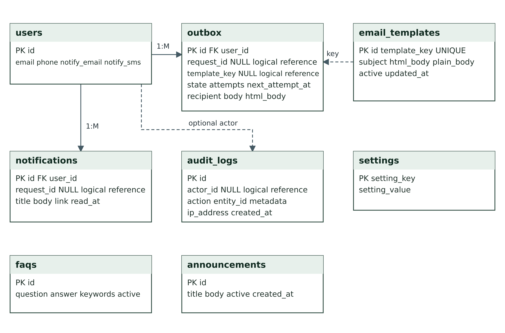
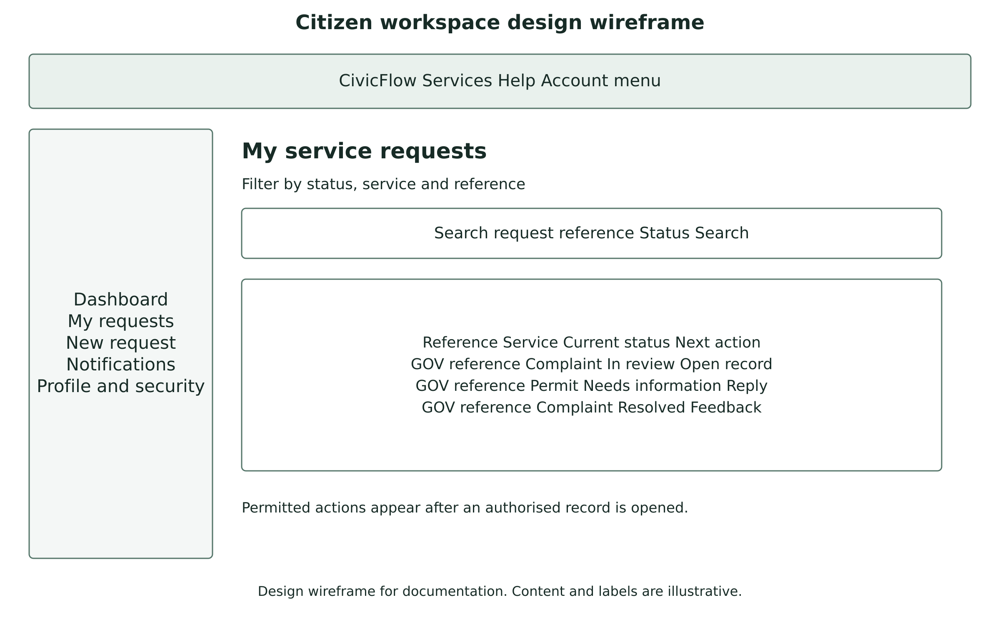
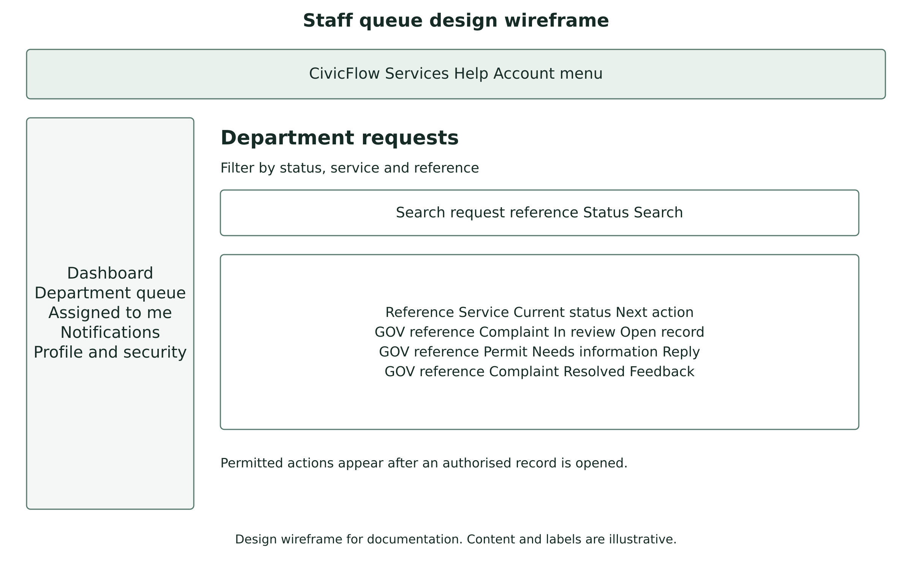

# Diagram and interface gallery

## Application architecture

## Core request entity relationships

## Identity and access relationships

## Communications and oversight relationships

## Request state workflow

## Notification delivery and retry

## Permission and record access

## Use case view

## Submission and information reply sequence

## Single instance deployment topology

## Citizen workspace wireframe

## Staff queue wireframe

## Planned remaining backlog

