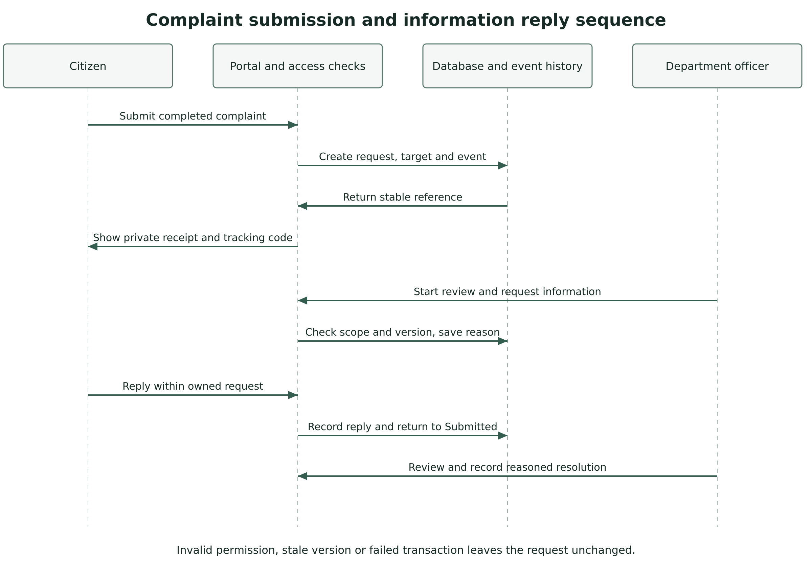

Iconic University

Sokoto Nigeria

Smart Government Service Delivery Platform

CivicFlow

# Architecture Design Document

Architecture decisions deployment and quality design

Group 1

MIT 820 Software Development Project I

| Group member | Registration number |
| --- | --- |
| Aminu Idris | 2630802400002 |
| Saidu Mustapha Suleman | 2630802400001 |
| Bolaji Watson | 2630802400009 |
| John Ojuekaiye Mayowa | 2630802400008 |
| Egbue Odira Celestine | 2630803400003 |

Document version 1.1   Application baseline 1.0.4   23 October 2026

Final presentation 28 November 2026
Portal submission 29 November 2026 before 11:59 p.m. WAT

## 1 Purpose and architectural drivers

This ADD explains the architecture of CivicFlow 1.0.4 and the decisions behind the source implementation. It complements the SRS and the complete System Design and Data Dictionary. The principal drivers are reliable request handling, confidentiality of evidence, accountable staff decisions, cPanel deployability and maintainable changes by a five-person team.

The implemented baseline is a single-instance, server-rendered PHP application with PDO, MySQL or MariaDB for hosting and SQLite for local evaluation. It uses a front controller, shared access checks, workflow modules and a CLI worker. It does not implement Laravel, a separate SPA, microservices or automatic cloud scaling.

## 2 Context and deployment view

Figure 2.1 Single instance deployment and trust boundaries

The host terminates HTTPS and applies clean-route and private-directory rules. PHP holds the session and enforces permissions before reading or changing data. Private attachment bytes, sessions and logs stay under protected storage. Cron invokes the worker through CLI. Configured providers form an external trust boundary, so their failure must not erase a committed request update.

## 3 Module and data responsibilities

| Module | Principal files | Responsibility |
| --- | --- | --- |
| Entry and bootstrap | index.php, app/bootstrap.php | Routes, configuration, runtime storage and session setup. |
| Access and account security | permissions.php, security.php, account_security.php | Action rights, record scope, tokens, MFA and session revocation. |
| Request domain | domain.php, actions.php, pages_workspace.php | Submission, state transitions, evidence and citizen/staff interactions. |
| Administration and communications | admin_actions.php, operations_actions.php, pages_admin.php | Catalogue, users, settings, templates and outbox controls. |
| Integration and worker | integrations.php, email_templates.php, cron/run.php | Configured delivery, guidance, retry and escalation. |
| Persistence | database.php and schema references | Prepared PDO statements, constraints, transactions and version checks. |

The schema separates identity, catalogue, requests, history, attachments, delivery and oversight. There are 21 tables. The data dictionary preserves the declared foreign keys and separately identifies application-enforced logical references. Request department and service are distinct so a permitted reroute can change processing ownership without rewriting the original service selection.

## 4 Architecture decision records

### ADR01 Modular monolith on PHP

A server-rendered PHP application matches the target cPanel deployment and keeps routing, sessions and review actions within one runtime. A separate SPA and API would increase cross-origin, build and deployment coordination. The consequence is a clear module convention and code review rather than framework-provided conventions.

### ADR02 PDO and relational persistence

MySQL or MariaDB fits hosted operation, while SQLite simplifies isolated evaluation. Prepared statements, transactions and constraints support consistency. The consequence is a need to verify both schema variants and perform full HTTP/PDO-MySQL acceptance on the target host.

### ADR03 Action permission with record scope

Role membership supplies capabilities, while ownership, department and organisation scope limit records. Internal evidence adds a visibility check. The consequence is that menus are insufficient security controls and every route, mutation and download must apply server-side checks.

### ADR04 Private files outside direct web access

Random filenames and protected storage separate uploaded bytes from public asset paths. Downloads check the parent request and visibility. MIME, size and quota checks constrain uploads. File hashes provide integrity metadata and do not provide malware scanning.

### ADR05 Durable outbox and scheduled worker

A request update commits locally before external delivery is attempted. The worker uses locking, conditional claims and bounded retries. The consequence is eventual external communication, an operational cron dependency and a distinction between provider acceptance and destination receipt.

### ADR06 Public-context optional AI

The local guide works without a provider. Configured AI receives a selected question and public service information and has no private-case or decision tool. The consequence is that guidance can be inaccurate and live provider acceptance remains a separate check.

### ADR07 Single-host baseline and scaling path

The release uses local sessions, files and job locks. This is suitable for a bounded single-host baseline. Multi-host expansion would require shared or externalised sessions and files, coordinated jobs, database capacity measurement and tested routing. No automatic scaling or high availability is claimed.

## 5 Formal behavioural views

Figure 5.1 Actor and use case view

Figure 5.2 Complaint submission and information reply sequence

State transitions, reasons and optimistic versions form the processing contract. Submitted enters In review before a final decision. Only a permit becomes Approved and only a complaint becomes Resolved. An owner reply returns Needs information to Submitted. Eligible withdrawal and complaint reopening follow the SRS business rules. Invalid transitions and stale writes leave the request unchanged.

## 6 Interface designs

Figure 6.1 Citizen workspace design wireframe

Figure 6.2 Department queue design wireframe

These wireframes describe navigation and screen responsibility. Citizen screens emphasise own requests, missing information and private tracking. Staff screens emphasise authorised queues and next actions. Actual labels, keyboard order, mobile wrapping, slider pause and reduced-motion behaviour must be reviewed in the rendered application.

## 7 Threat and quality review

| Threat or failure | Implemented measure | Remaining verification |
| --- | --- | --- |
| Other-user or other-department access | Permission plus record scope; private draft and attachment checks. | Repeat negative hosted journeys and review custom roles. |
| Forged or stale updates | CSRF, transactions, allowed states and request versions. | Concurrent-update and failure review on the target database. |
| Malicious or exposed upload | MIME and quota checks, random private names and protected download. | Malware control policy and independent security review. |
| Account compromise | Password hashing, single-use tokens, optional TOTP MFA and device revocation. | Staff MFA policy and account recovery review. |
| Provider outage | In-app update, held outbox, retry limit and local service guide. | Real account and destination-receipt checks. |
| Capacity or host loss | Single-host baseline with backup procedure. | Workload benchmark and timed restoration. |

Proposed pilot targets are a 95th-percentile principal-page response within 2.5 seconds under 10 concurrent users and 10,000 stored requests, RPO no greater than 24 hours and RTO within four hours. These are planning targets, not measured results. ASVS 5.0.0, NIST SP 800-218 version 1.1 and WCAG 2.2 inform the review questions; the project makes no full-conformity claim.

## 8 Release and architecture review

Code changes identify an affected requirement and ADR where relevant. A reviewer checks that documentation, schema references, tests and deployment consequences remain aligned. The extracted cPanel package must preserve private directories and clean routes. The repository omits private setup keys and creates a unique key only for a local installation or privately built deployment archive.

Architecture reviewer and date ____________________________________

Security and data reviewer and date _________________________________

Supervisor review and conditions __________________________________
