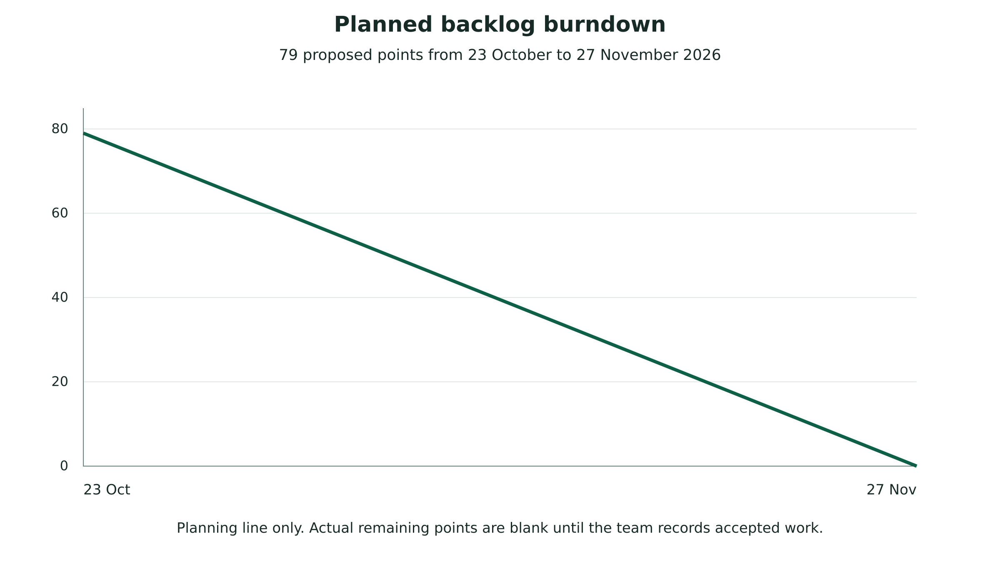

Iconic University

Sokoto Nigeria

Smart Government Service Delivery Platform

CivicFlow

# Project Monitoring and Evaluation Records

Weekly reporting sprint controls and contribution evidence

Group 1

MIT 820 Software Development Project I

| Group member | Registration number |
| --- | --- |
| Aminu Idris | 2630802400002 |
| Saidu Mustapha Suleman | 2630802400001 |
| Bolaji Watson | 2630802400009 |
| John Ojuekaiye Mayowa | 2630802400008 |
| Egbue Odira Celestine | 2630803400003 |

Document version 1.1   Application baseline 1.0.4   23 October 2026

Final presentation 28 November 2026
Portal submission 29 November 2026 before 11:59 p.m. WAT

## 1 Recording and review procedure

This pack provides the records required to monitor Group 1 against MIT 820. Bolaji maintains the registers, while each member supplies evidence for their own work. Enter actual meeting dates, decisions, completed work and review results. The prepared fields and proposed backlog are planning records until completed and reviewed.

The repository contains editable Markdown templates and CSV registers alongside this printable pack. Link actual GitHub issues, commits and pull requests after the repository is uploaded. Each weekly report includes work completed, work planned, blockers and the current live-build link.

## 2 Weekly progress report form

Reporting period ____________________   Report number ______________

Prepared by ________________________   Date ________________________

Current live build URL and release __________________________________

Independent access check and date __________________________________

### Work completed and evidence

________________________________________________________________

________________________________________________________________

### Work planned for the next period

________________________________________________________________

________________________________________________________________

### Blockers and support required

________________________________________________________________

________________________________________________________________

### Risks or scope changes

________________________________________________________________

________________________________________________________________

### Supervisor feedback and next review

________________________________________________________________

________________________________________________________________

## 3 Supervisor meeting minutes form

Meeting date and time WAT _________________________________________

Meeting mode or location __________________________________________

Attendees and apologies ___________________________________________

Agenda and relevant requirement or gate ____________________________

Decision and approval conditions __________________________________

Next review date __________________________________________________

| Action | Owner | Due date | Evidence and status |
| --- | --- | --- | --- |
| ________________ | ____________ | __________ | ________________ |
| ________________ | ____________ | __________ | ________________ |
| ________________ | ____________ | __________ | ________________ |

## 4 Sprint plan and review

| Sprint | Dates in 2026 | Review focus |
| --- | --- | --- |
| 1 | 23 October to 1 November | Scope, SRS, architecture, models and repository baseline. |
| 2 | 2 to 15 November | Integration, security boundaries, usability and defect correction. |
| 3 | 16 to 27 November | Hosted acceptance, recovery, final documents and rehearsal. |

The proposed backlog totals 79 points. An estimate is a planning unit rather than a duration or assessment mark. At sprint planning the group confirms scope and capacity. A done item must have linked evidence and review. Preserve the original estimate and record scope changes separately so the remaining-work history is intelligible.

Figure 4.1 Planned backlog burndown

Sprint review date and attendees __________________________________

Accepted items and evidence _______________________________________

Unfinished items and reason ________________________________________

Retrospective action owner and due date ____________________________

## 5 Risk and issue register

| ID and risk | Owner | Treatment | Review evidence |
| --- | --- | --- | --- |
| R01 Approval evidence missing | Bolaji | Obtain dated proposal record and conditions. | ________________ |
| R02 Hosted system inaccessible | Aminu | Independent access check and local contingency. | ________________ |
| R03 Private records exposed | Aminu | Repeat permission, upload and protected-path tests. | ________________ |
| R04 Scope or provider delay | Bolaji | Prioritise core workflow and record provider dependencies. | ________________ |
| R05 Insufficient quality evidence | John | Complete browser, capacity and recovery records. | ________________ |
| R06 Contribution history incomplete | All members | Link actual commits, reviews and peer assessment. | ________________ |

## 6 Individual contribution and peer assessment

| Member and registration | Allocated responsibility | Evidence and reviewer |
| --- | --- | --- |
| Aminu Idris 2630802400002 | Development | Commit or PR __________________ Artifact _______________________ Reviewer ______________________ |
| Saidu Mustapha Suleman 2630802400001 | Documentation | Commit or PR __________________ Artifact _______________________ Reviewer ______________________ |
| Bolaji Watson 2630802400009 | Project management | Commit or PR __________________ Artifact _______________________ Reviewer ______________________ |
| John Ojuekaiye Mayowa 2630802400008 | Development | Commit or PR __________________ Artifact _______________________ Reviewer ______________________ |
| Egbue Odira Celestine 2630803400003 | Documentation | Commit or PR __________________ Artifact _______________________ Reviewer ______________________ |

Each member records the problem addressed, files or artifacts changed, test or review evidence and the corresponding issue or pull request. Peer assessment should describe the actual contribution and collaboration observed. Do not reconstruct Git commits or backdate records to imply work that the repository history does not contain.

## 7 Consent and usability observation

Explain the purpose, tasks, voluntary participation, information recorded, storage period and contact person before a usability session. Use an approved consent process. Permit withdrawal, avoid recording passwords or private cases, and use an anonymised participant ID. Obtain separate permission for any audio or screen recording and follow the university supervisor’s requirements.

| Field | Observation |
| --- | --- |
| Participant ID and consent reference | ____________________________ |
| Task and environment | ____________________________ |
| Completion and assistance required | ____________________________ |
| Error, time and participant comment | ____________________________ |
| Action, owner and review date | ____________________________ |

## 8 Hosted test and recovery record

Environment URL and application release ____________________________

Database and PHP version __________________________________________

Test date checker and evidence ____________________________________

Workload method and response-time result ___________________________

Backup reference and restore environment ___________________________

Measured recovery point and recovery time __________________________

Failures defects and release decision ______________________________

## 9 Final defence and submission record

Confirm the approved proposal, reviewed SRS and ADD, current report, manuals, tests, code and independent live access before defence. Keep the evaluation password in the agreed private channel. Rehearse the workflow and questions with all five members. After the 28 November presentation, record the panel’s corrections and complete the portal submission before 11:59 p.m. WAT on 29 November.

Defence build and independent checker ______________________________

Panel feedback and correction owner ________________________________

Submission file list and final review _______________________________

Portal submission date time and receipt reference __________________

Project manager sign off __________________________________________
