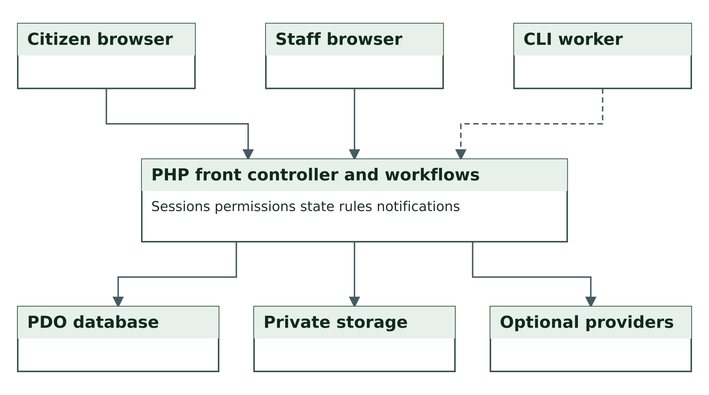
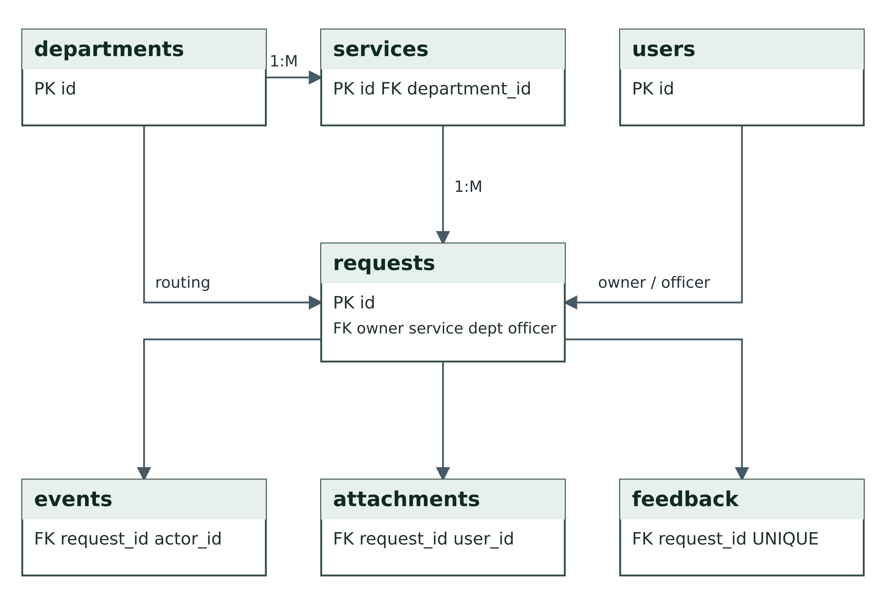
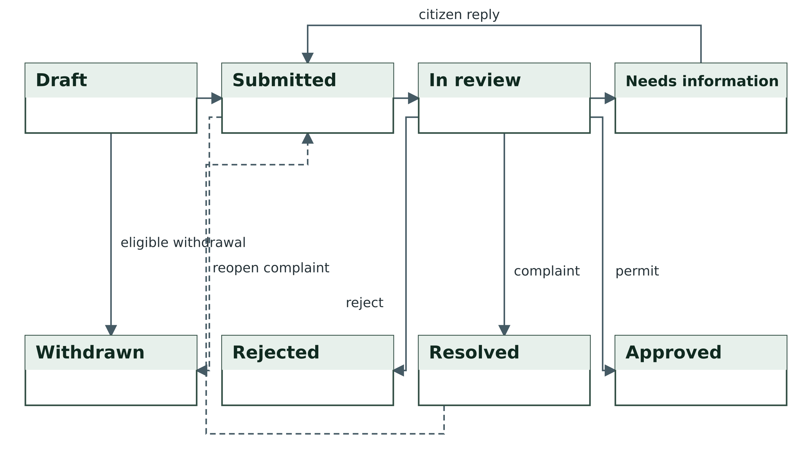
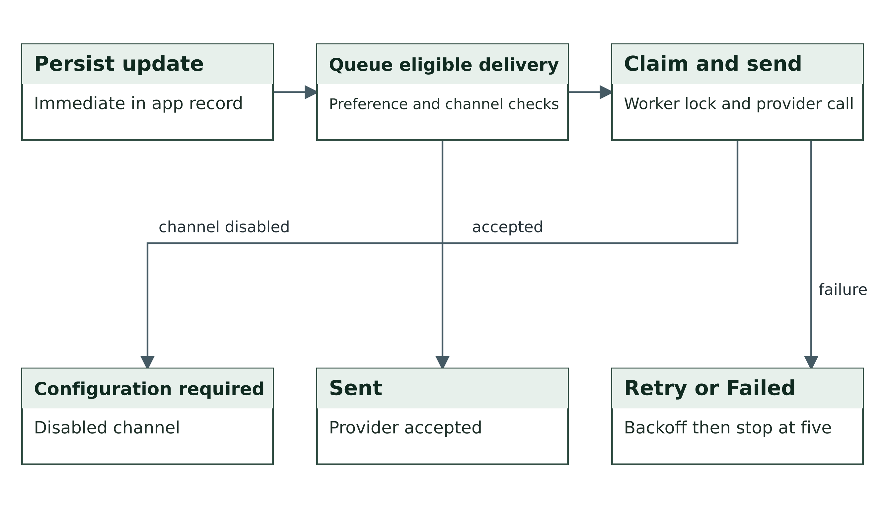
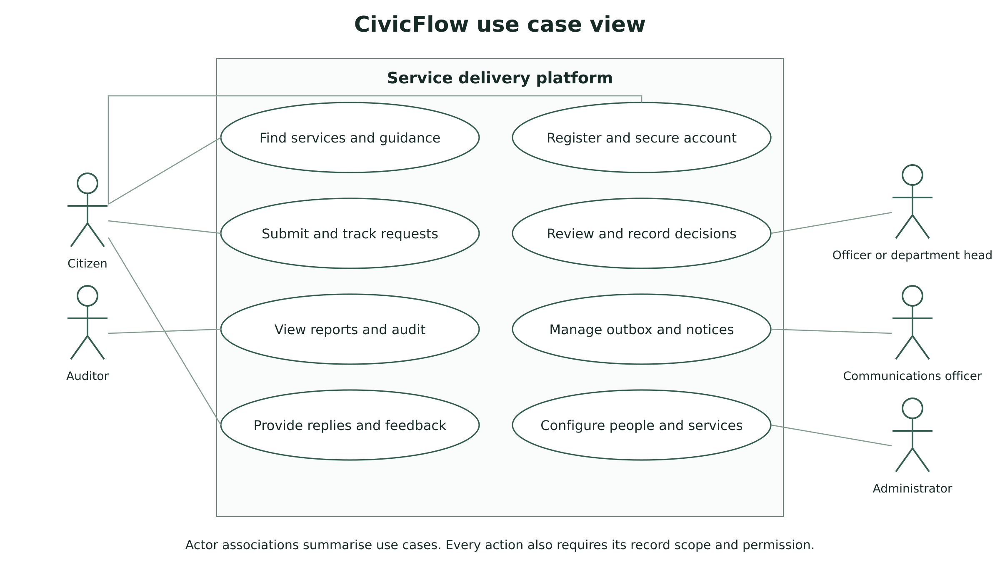

# Smart Government Service
Delivery Platform

CivicFlow

Academic Project Report

Group 1

| Group member | Registration number |
| --- | --- |
| Aminu Idris | 2630802400002 |
| Saidu Mustapha Suleman | 2630802400001 |
| Bolaji Watson | 2630802400009 |
| John Ojuekaiye Mayowa | 2630802400008 |
| Egbue Odira Celestine | 2630803400003 |

Submitted for MIT 820 Software Development Project I

Iconic University Sokoto Nigeria

Master of Information Technology programme

Supervisor __________________________________

Application baseline 1.0.4   Documentation revision 23 October 2026

Presentation 28 November 2026

Portal submission 29 November 2026

# Declaration and approval

We accept responsibility for the report and implementation submitted for assessment. Reused template material, libraries and reference sources are identified. Each member should confirm the work and contribution being submitted before signing.

| Group member | Registration number | Signature | Date |
| --- | --- | --- | --- |
| Aminu Idris | 2630802400002 |  |  |
| Saidu Mustapha Suleman | 2630802400001 |  |  |
| Bolaji Watson | 2630802400009 |  |  |
| John Ojuekaiye Mayowa | 2630802400008 |  |  |
| Egbue Odira Celestine | 2630803400003 |  |  |

### Supervisor approval

This project report is presented for review and assessment in Software Development Project 1.

Supervisor name _____________________________________

Signature __________________________________________

Date ______________________________________________

Assessment or approval record __________________________

# Acknowledgements

We wish to acknowledge the academic guidance associated with the course and the support of our colleagues and families. We also acknowledge the authorised campus-template reference, open-source software maintainers and the published research and technical sources cited in this report.

# Abstract

Citizens need a dependable way to submit government service requests without repeated physical visits and uncertain follow-up. We developed CivicFlow, a web platform for complaints, permit applications, private document submission and service tracking. The project combines an artefact development approach with iterative implementation and scenario-based evaluation. PHP and PDO implement the service workflows, MySQL or MariaDB supports hosted deployment, and SQLite supports isolated evaluation. Six default roles and additional action permissions separate citizen, departmental, communications, oversight and administrative responsibilities. Release 1.0.4 includes a public service landing page, controlled requests, an external notification outbox, scheduled escalation and optional AI assistance grounded in public service information. The retained release evidence records 267 passed automated assertions, comprising 124 workflow and security, 13 fresh-installation, five installer, 113 landing and dataset, and 12 carousel-fixture assertions. These counts establish selected behaviours under their recorded local conditions. They do not establish hosted MySQL acceptance, real provider receipt, accessibility conformity, measured service improvement or full security coverage. This report documents the requirements, design decisions, implementation and evaluation and connects them to the MIT 820 project gates. The accompanying PID, ADD, project registers and repository support continued review, live defence and final submission.

Keywords: digital government, citizen services, workflow automation, role based access control, service tracking

# Abbreviations

| Abbreviation | Meaning |
| --- | --- |
| AI | Artificial intelligence |
| API | Application programming interface |
| CSRF | Cross site request forgery |
| CSV | Comma separated values |
| ERD | Entity relationship diagram |
| FK | Foreign key |
| HTTP | Hypertext transfer protocol |
| MFA | Multi factor authentication |
| PDO | PHP Data Objects |
| PK | Primary key |
| RBAC | Role based access control |
| SLA | Service level agreement or configured service target |
| SMTP | Simple Mail Transfer Protocol |
| SRS | Software requirements specification |
| TOTP | Time based one time password |
| WAT | West Africa Time UTC plus one |

## CHAPTER ONE  INTRODUCTION

### 1.1 Background of the study

Access to a public service often involves several separate activities: finding the correct office, learning what documents are required, completing an application, providing evidence and returning to ask about progress. A complaint may follow another route, even when it concerns the same department. When these activities rely on a physical counter or disconnected messages, the citizen has limited visibility of what has happened after submission. The project brief identifies delays, long queues and poor transparency as the problem to address.

Digital government places service access and administrative processing within a common information environment. The UN E-Government Survey 2024 examines digital government development and includes attention to local online services and the governance of emerging technologies (United Nations Department of Economic and Social Affairs, 2024). For this project, that broad context is translated into a specific software problem: how to connect an individual request to an accountable department, a recorded decision and a status history the citizen can inspect.

CivicFlow combines complaints and permit applications in one account-based platform. It supports online forms, private supporting documents, department routing, officer review, information requests and recorded outcomes. A citizen can follow a submission through the signed-in portal or inspect limited progress with a reference and a private tracking code. Email, SMS and AI are configurable connections rather than requirements for the basic request workflow to function.

The software reuses the visual shell of the user-supplied campus portal where it fits service delivery. Academic functions such as results and course enrolment are outside the application. The citizen workspace retains useful navigation, panels and responsive layout patterns, with a new CivicFlow identity. This reuse reduces interface construction effort while the service database, permission controls and processing rules address the current project.

### 1.2 Statement of the problem

The problem is not simply the absence of an electronic form. A form that forwards an email can still leave a citizen uncertain about receipt, responsibility and progress. A useful service platform must preserve ownership, evidence, the responsible department and a history of actions after the original submission.

The project therefore addresses four connected weaknesses described in the brief. Citizens need a consistent submission route. Departments need structured review and communication. Both parties need a reliable record of progress. Administrators need to control who can view documents or make decisions. These weaknesses also create a design tension: greater transparency for the owner must not expose private records to other citizens or unrelated staff.

No field survey or time-and-motion study was undertaken for this release. The problem statement comes from the supplied project proposal and defines the design context. It should not be read as a quantified finding about a named government department.

### 1.3 Aim and objectives

The aim is to design, implement and evaluate a Smart Government Service Delivery Platform that enables citizens to submit and track service requests while authorised staff process them through a controlled workflow.

- Develop citizen registration, sign-in, recovery and account-security functions.

- Implement complaints and permit applications with private supporting documents and editable drafts.

- Provide department routing, officer review, requests for information and reasoned final decisions.

- Enforce role permissions and record scope on screens, actions and document downloads.

- Provide progress tracking, in-app notices, a managed external notification outbox and optional AI assistance.

- Evaluate the implemented behaviours with repeatable functional and access-control checks and prepare deployment and user documentation.

### 1.4 Research questions

- How can the citizen and staff activities be represented in one traceable service lifecycle?

- How can the application restrict request data and actions according to ownership, department and role permissions?

- How can notifications and assistance remain usable when external services are unavailable?

- Which implemented requirements can the available test evidence verify, and which outcomes require a hosted pilot?

### 1.5 Scope of the project

The release covers a browser-based citizen portal and staff workspace. A service catalogue determines the responsible department, supporting requirements and calendar-hour target. Citizens create complaints and permit applications, retain drafts, upload documents, respond to officers, withdraw eligible requests, reopen resolved complaints and leave feedback after a decision. Officers process submitted records within their department. Additional roles support departmental oversight, communications, audit and administration.

Supporting functions include email verification, password recovery, authenticator-based MFA, device-session revocation, private receipts, printable approval records, limited public tracking, public approval verification, operational reports and an audit trail. Apache rules provide extension-free addresses. A scheduled PHP command handles escalation and outbox delivery. SMTP, Termii SMS and OpenAI Responses are optional operator-configured interfaces.

Payment collection, national identity verification, integration with an actual government register, cryptographically signed statutory permits, automated record erasure and antivirus scanning are outside the implemented scope. A printable approval is an application record whose authority depends on the issuing organisation. The platform itself does not establish government affiliation.

### 1.6 Significance of the project

The citizen receives a consistent place to submit information and view the next step. Staff receive a departmental queue and can explain an information request without separating it from the original record. Administrators can distinguish reviewing, deciding, routing, exporting and communications rights rather than giving every staff account the same powers.

The digital-economy relevance lies in replacing disconnected service interactions with reusable digital records and accountable processing. The design can support remote access and reduce unnecessary follow-up visits where an authority adopts and operates it effectively. These are intended benefits. This report does not present unmeasured savings, queue reductions or user-satisfaction improvements as achieved results.

### 1.7 Limitations of the study

Evaluation used synthetic requests and controlled accounts. It did not involve a representative citizen sample, a statutory approval process or an operational government department. The HTTP acceptance suites ran with SQLite. MariaDB executed the schema and selected queries in bootstrap mode, but local socket restrictions prevented a complete HTTP/PDO-MySQL run. Apache syntax validation does not establish how a particular host will apply overrides or subdirectory rewrites.

No live SMTP mailbox, funded SMS account or AI credential was supplied for provider acceptance. Browser, accessibility, capacity, backup restoration and independent security assessment remain separate checks. These limits constrain claims about public deployment, rather than removing the value of the tested application behaviours.

### 1.8 Organisation of the report

Chapter One establishes the problem and scope. Chapter Two reviews digital-government, adoption, design and access-control literature. Chapter Three explains the methodology and system design. Chapter Four describes implementation, validation and the observed results. Chapter Five presents conclusions and recommendations. The supporting submission files provide the detailed SRS, schema dictionary, diagram sources, user manuals, test evidence, presentation and setup material.

## CHAPTER TWO  LITERATURE REVIEW

### 2.1 Introduction

The review combines research literature with primary public-sector and technical sources. It identifies ideas that inform the design and separates those ideas from claims that would need field evaluation. The comparison concerns service access, administration, accountability, user acceptance and software verification.

### 2.2 Digital government and public service delivery

The UN survey considers the development of national and local digital services and proposes a framework for planning and assessment. Its treatment of local services is relevant because the citizen interacts with a particular application and authority, not an abstract national technology programme (United Nations Department of Economic and Social Affairs, 2024). The implication for CivicFlow is to make the operational service, requirements, department and progress visible within each request.

The World Bank groups GovTech maturity into core government systems, online public service delivery, citizen engagement and enabling conditions. Its framework makes clear that an online front end is only one part of public-sector digital transformation (World Bank, n.d.). CivicFlow addresses a bounded part of that landscape. Its forms and tracking support access, while department queues and reports support processing. Institutional authority, staff capacity, actual service standards and adoption remain responsibilities of the operating organisation.

### 2.3 Design science as a project approach

Hevner et al. (2004) describe design science in information systems through the construction and evaluation of purposeful artefacts. This provides a suitable basis for a software project whose immediate output is an implemented service platform. Our artefact comprises the application, requirements model, relational schema, workflow rules and supporting deployment material.

The evaluation in this project asks whether specified behaviours occur and whether prohibited actions fail. It does not test a general social theory or infer a population-level improvement from technical checks. The distinction helps connect the project's contribution to the evidence actually collected.

### 2.4 Adoption and the design context

Davis (1989) examines perceived usefulness and perceived ease of use in technology acceptance. These constructs provide a useful lens for later citizen evaluation. A comprehensible service catalogue and a visible request history are plausible design choices, but their presence does not by itself demonstrate acceptance. A future pilot should measure task completion and obtain informed feedback from actual users.

Heeks (2003) examines the risks that arise when an e-government design differs from the context in which it must operate. This is relevant to assumptions about internet access, staff responsibilities and operating resources. The project responds with a configurable service catalogue, local guidance when AI is unavailable and an outbox that holds delivery when a provider is unconfigured. Those choices still require an organisation to assign staff and maintain the service.

### 2.5 Role based access control

The NIST RBAC material explains the assignment of users to roles and privileges to those roles (National Institute of Standards and Technology, 2026). CivicFlow uses that relationship to separate citizen, officer, department head, auditor, communications and administrator responsibilities. Additional staff roles combine permitted capabilities.

Role membership alone is insufficient for this application. An officer also needs authority over the particular record. The implementation therefore combines action permission with own, department or organisation scope. Internal notes and attachments require an additional visibility permission. These record constraints are application-specific design decisions rather than a claim of formal RBAC-standard certification.

### 2.6 Related public service system

India's CPGRAMS offers grievance submission, status tracking, role-based departmental access and feedback through a public portal. Its published description also includes an appeal facility after an unsatisfactory resolution (Department of Administrative Reforms and Public Grievances, n.d.). These functions illustrate how service delivery extends beyond initial receipt.

The comparison informs our use of request identifiers, departmental review and feedback. CivicFlow also includes permit applications and private supporting documents within its bounded project scope. Its complaint reopening feature should not be equated with a legally defined appeal process. We did not inspect CPGRAMS internal architecture or claim equivalent operational scale.

### 2.7 Security and requirements guidance

OWASP describes ASVS as a basis for specifying and testing web-application technical security controls (OWASP Foundation, n.d.). The project uses explicit requirements and negative access tests to make security behaviour reviewable. This is an approach to verification, not an assertion that the full ASVS has been assessed or certified.

ISO/IEC/IEEE 29148:2018 concerns requirements-engineering processes and information items. Its published scope supports the importance of structured requirements and verifiable acceptance criteria (International Organization for Standardization, 2018). The accompanying SRS uses identifiers, actors, business rules and evidence mappings. It is a project specification, not a reproduced standard or a conformity certificate.

The PHP manual documents prepared statements and password hashing (PHP Documentation Group, n.d.). The implementation uses prepared PDO calls and a bounded password input with PHP password hashing. These controls support the design but must operate alongside file isolation, session management, permission checks and secure hosting.

NIST SP 800-218 version 1.1 provides a secure-development framework that can be incorporated into an SDLC (Souppaya et al., 2022). We use its emphasis on protected source, explicit security requirements and reviewable release evidence to organise the repository and project gates. OWASP ASVS 5.0.0 informs the verification questions, while WCAG 2.2 informs the planned keyboard, form and presentation review (OWASP Foundation, 2025; World Wide Web Consortium, 2024). These references guide the evaluation; this project does not claim full standard conformity.

### 2.8 Comparative analysis

Table 2.1 Comparative analysis

| Source or approach | Relevant contribution | Boundary for this project |
| --- | --- | --- |
| UN digital government framework | Connect digital services with planning and local service access. | A framework does not validate this application or its social impact. |
| World Bank GovTech framework | Consider front-end delivery alongside administrative systems and engagement. | This project does not implement national shared infrastructure. |
| CPGRAMS | A public example of submission, tracking, departmental access and feedback. | No equivalence in authority, appeal process or scale is claimed. |
| Design science | Build and evaluate a purposeful software artefact. | Technical evaluation cannot establish public adoption. |
| Technology acceptance research | Assess usefulness and ease of use with users. | A citizen acceptance study remains future work. |
| RBAC and verification guidance | Make permissions and negative security behaviours explicit. | The application has no independent security certification. |

### 2.9 Identified design gap

The design gap addressed here is the integration of citizen access with accountable request processing in a deployable course-project application. A basic contact form does not supply a controlled lifecycle, private documents, departmental decisions and a durable notification record. A general framework does not provide the implementation needed to demonstrate those behaviours.

CivicFlow contributes a concrete implementation with traceable requirements and repeatable tests. Its value should be assessed at that level. Establishing service-time improvements, inclusion, satisfaction and institutional effectiveness requires a subsequent pilot with appropriate authority and evaluation procedures.

## CHAPTER THREE  METHODOLOGY AND SYSTEM DESIGN

### 3.1 Development approach

We used an artefact development approach with iterative implementation and scenario-based evaluation. The project began with the service-delivery brief and the authorised campus-template reference. Requirements were translated into user roles, record ownership, department scope and a request state model. Implementation then connected those models to forms, staff actions, private files, notifications and administrative controls.

The development cycle consisted of defining an expected behaviour, implementing the corresponding module, exercising it through HTTP requests and correcting mismatches. Negative scenarios were included deliberately. For example, a second citizen should fail to read another owner's attachment even when the document identifier is known. This approach makes the stated security boundary part of the functional design.

The evidence base comprises the supplied proposal, the implemented source, generated schema references and executable acceptance logs. It does not include interview transcripts, questionnaire responses or measured government-office transaction data. The institutional setting is therefore a proposed service-delivery environment rather than a named department that has already adopted the software.

### 3.2 Analysis of the existing service scenario

The baseline scenario is a citizen visiting a department, obtaining requirements, submitting a complaint or application and making further enquiries about progress. A department may keep records separately from the citizen's evidence of submission. This scenario follows the problem brief and is an analytical model, not an observational study of a particular office.

The proposed system changes how information moves. A published service explains the requirements before the form begins. Submission creates one reference, assigns a department and records the event. Staff review within an authorised workspace and communicate through the same request. The citizen can inspect the recorded status without depending on a separate message chain. A service target and escalation record make delay visible, although staff and institutional resources still determine the real outcome.

### 3.3 Requirements derivation

Requirements were grouped into citizen access, request processing, communication, oversight and deployment. Each group was decomposed into functions with an actor and an observable acceptance condition. The detailed SRS provides the FR identifiers and their verification evidence. Table 3.1 summarises the main design responsibilities.

Table 3.1 Requirements derivation

| Concern | Design responsibility | Evidence or output |
| --- | --- | --- |
| Citizen access | Create and secure an account; preserve ownership. | Registration, session, reset and MFA checks. |
| Submission | Capture structured complaints and permit evidence. | Forms, MIME validation, draft and submission checks. |
| Processing | Route, review and record permitted decisions. | Request lifecycle and version-control checks. |
| Communication | Persist notices and manage provider failures. | In-app notices, outbox states and retry evidence. |
| Oversight | Limit reports to authorised records and record actions. | Scoped export and audit checks. |
| Deployment | Provide clean routes and a repeatable installation. | Installer, schema references and release-extraction gate. |

### 3.4 Feasibility analysis

Technical feasibility follows from a conventional PHP and relational-database deployment supported by the target hosting model. The implementation requires PHP 8.2 or later, PDO, Fileinfo, Mbstring and OpenSSL. cURL supports provider connections and DOM/XML supports structured email sanitisation. MySQL or MariaDB is the hosted database; SQLite provides a simpler local evaluation route. These requirements describe compatibility and initial configuration, not measured capacity.

Operational feasibility depends on assigning real departments, reviewing published requirements, maintaining officers and monitoring the outbox. The application can hold messages when a provider is disabled, but it cannot supply an unavailable officer or make an administrative decision by itself. The operator must also define approval authority, retention, support and recovery procedures.

Economic feasibility was considered by identifying cost categories rather than inventing a quotation. Hosting, domain and TLS administration, backup storage, mail delivery, SMS usage and optional AI usage may incur costs. Existing hosting and open-source components can reduce initial implementation expense, while provider charges depend on actual accounts and usage. No monetary saving or fixed operating budget was measured.

### 3.5 System architecture

The browser connects to a front controller through clean Apache routes. The application establishes the session, validates the request and checks the required permission. Workflow modules use PDO to persist records and private storage to retain attachments. A CLI worker invokes escalation and delivery functions without exposing a public job endpoint.

Figure 3.1 shows the application boundary. The local service guide works from published FAQ records. Optional AI sends a chosen question and public service facts through the configured server-side connection. It has no capability to inspect private cases or change a decision. The outbox separates recording an update from attempting external delivery.

Figure 3.1 Application architecture

Source: Project implementation and system design for release 1.0.4.

### 3.6 Actors and permission design

Six default roles establish useful starting responsibilities. Citizens access their own requests. Officers and department heads work within their assigned department. Auditors inspect submitted records and reports without default decision or internal-note rights. Communications officers manage notices, templates and public guidance without case access. Administrators manage the workspace and the permission catalogue.

Custom roles can separate intake review from final decisions. Additional staff roles combine permissions, while the public citizen role is constrained to the allowed citizen capability set. Account and permission changes invalidate affected authenticated sessions. Requests in draft status remain private to their owner even when another user has organisation-wide access.

Record scope and action permission are evaluated independently. A user who can read a department's request does not automatically have the right to approve it, reroute it or export it. The same principle applies to attachments: document-download permission, access to the parent record and staff-only visibility must all be satisfied. Hiding a menu item is a usability measure, while these server checks enforce the boundary.

### 3.7 Database design

The schema contains 21 application tables. Departments and services describe the published catalogue. Users, roles and role permissions describe access. Requests store the owner, service, current department, optional assigned officer, status and target. Events preserve the history and visibility of updates. Attachments store the file metadata and the parent request, while private storage holds the file bytes.

Requests reference a service and a department separately so that later routing can change the processing department without replacing the selected service. A version field supports optimistic concurrency. Feedback has a unique request reference so the citizen can record only one rating for a closed cycle. Reopening a resolved complaint removes the earlier feedback and refreshes the target.

Repeated information is separated into related tables rather than embedded in a single request record. The schema uses primary, unique and foreign-key constraints where declared. Some associations, including the primary role field and selected outbox and audit links, are application-enforced logical references. They must not be described as database foreign keys. The accompanying schema dictionary distinguishes both forms and lists every column and declared constraint.

Figure 3.2 Core service entity relationships

Source: Project implementation and system design for release 1.0.4.

Identity and communication views appear in the separate System Design and Data Dictionary document. The diagrams show selected relationship lines for readability, while FK labels and the complete constraint list preserve the remaining actor and uploader references. The SQL reference files in the source directory are the implementation authority.

### 3.8 Request lifecycle and processing rules

The request lifecycle begins with a private draft or a submitted record. A draft has no service target or officer assignment. Submission sets the service department, starts the target in calendar hours and selects the least-loaded active authorised reviewing officer in that department where one is available. A record may remain unassigned when no suitable officer exists.

Staff begin review before recording an outcome. From review, they may request more information, reject the request, approve a permit or resolve a complaint. A citizen response to Needs information returns the record to Submitted. An officer may also resume review directly. Eligible owner withdrawal is limited to Draft, Submitted and Needs information. Only a resolved complaint can reopen.

The target does not pause while information is awaited. The worker escalates an overdue open cycle once, recording the event and notifying appropriate users. A reopened complaint starts a new cycle with a fresh target. The workflow is shown in Figure 3.3.

Figure 3.3 Complaint and permit lifecycle

Source: Project implementation and system design for release 1.0.4.

### 3.9 Notification and assistance design

In-app notifications provide the immediate record of an update. Routine email and SMS follow the account's preferences. The outbox stores the rendered message, channel, recipient, state and retry information so that editing a template does not alter an already queued notice. Authentication messages support verification and recovery and hide their sensitive body from the outbox interface.

A disabled channel produces Configuration required. An enabled channel produces Pending, which a worker claims conditionally under a private lock. Provider acceptance produces Sent. Failure produces a scheduled retry, with backoff capped at one hour, until the fifth failed attempt produces Failed. The operator can review and requeue eligible records. Sent means provider acceptance rather than confirmed inbox or handset delivery.

The assistant provides published-service guidance. The local guide remains available without a provider. Optional AI is restricted by instructions and supplied public context, but it can still be inaccurate. It is presented as assistance and does not replace an officer's decision. Figure 3.4 summarises the delivery workflow.

Figure 3.4 Notification delivery and retry workflow

Source: Project implementation and system design for release 1.0.4.

### 3.10 Interface and input design

The citizen dashboard presents requests, progress and next actions after registration or sign-in. Service details precede the application form, and the form identifies supporting requirements. The staff workspace exposes department queues, history and permitted actions. Communications accounts receive operational tools suited to their rights rather than a citizen submission prompt.

Inputs are checked on the server. The password boundary is 12–72 bytes with letters and numbers. Supported uploads are PDF, JPEG and PNG, at most 5 MB each and three per upload. The application also limits a request to 20 attachments and an uploading account to 100 MB. These limits are initial resource controls and may be reviewed for the intended service policy. File hashes support integrity records; they are not malware-detection results.

### 3.11 Evaluation design

The acceptance harness creates an isolated application copy, chooses a loopback HTTP port, installs synthetic accounts and exercises expected and prohibited interactions. Database assertions verify the persisted result after a form action. The live-mode suite separately checks that a fresh operational installation does not publish sample services or seed sample citizens and requests.

The principal measures are the count of passed assertions, observed status changes, permitted and denied HTTP access, and evidence of safe failure when SMTP cannot connect. A separate release gate extracts the deployment ZIP before evaluation to verify that runtime directories survive packaging. No response-time threshold, concurrent-user capacity or human satisfaction score is inferred from these tests.

### 3.12 Project governance and stakeholder review

MIT 820 requires a formal proposal approval gate before development, followed by requirements and architecture review, prototype review, system testing, deployment and defence. The PID records the business case, responsibilities, risks and approval fields. The ADD records architectural alternatives, decisions and their consequences. The existing software baseline provides implementation evidence; it does not establish that a historical supervisor approval meeting occurred.

We propose hybrid delivery for the remaining period. Review gates control scope and release readiness, while three short sprints organise verification, corrections and documentation. Bolaji maintains the backlog and weekly reports. Development links changes to requirements and tests. Documentation checks that diagrams, manuals, the report and slides describe the same release. Another member reviews each completed item before its estimate is removed from the remaining backlog.

Stakeholder analysis distinguishes citizen needs, officer workflow, departmental oversight, communications, independent audit and technical operations. The current requirements derive from the supplied brief and source behaviour. Proposed stakeholder walkthroughs will compare these assumptions with actual service practices. Any participant session requires informed consent and anonymised notes. No completed interview or user sample is inferred from these proposed activities.

### 3.13 Formal models and interface designs

The use case view links the principal actors to the supported activities. The sequence view traces complaint submission and a request for further information through the portal and persistence boundary. The ADD also includes deployment topology and citizen and staff wireframes. The wireframes document screen responsibilities and must be distinguished from screenshots of a measured live session.

Figure 3.5 Principal actors and use cases

Figure 3.6 Complaint submission and information reply sequence

## CHAPTER FOUR  IMPLEMENTATION TESTING AND DISCUSSION

### 4.1 Implementation environment

CivicFlow 1.0.4 uses PHP, HTML, CSS and local JavaScript. PDO provides database access with prepared calls. The validation runtime was PHP 8.3.6. The deployment schema targets MySQL or MariaDB, and the HTTP acceptance environment used PDO SQLite. Private directories hold uploaded documents, sessions, rate-limit state and application logs.

The web installer accepts the organisation name, exact installation URL, fresh database details and an administrator chosen by the operator. It checks the setup key and creates an installation lock after configuration. Live mode creates no sample citizen records and leaves starter services inactive with zero fees. Demonstration mode deliberately adds synthetic examples and marks approvals as demonstrations.

### 4.2 Module implementation

Table 4.1 Module implementation

| Module group | Principal source files | Implemented responsibility |
| --- | --- | --- |
| Entry and rendering | index.php; app/bootstrap.php; app/layout.php | Routes, configuration, headers, sessions and shared portal shell. |
| Identity and access | security.php; permissions.php; account_security.php | Authentication, record scope, role rights, MFA and device sessions. |
| Service workflow | domain.php; actions.php; pages_workspace.php | Submission, routing, status transitions, replies, files and reports. |
| Administration | admin_actions.php; pages_admin.php; operations files | People, catalogue, departments, permissions and controlled communications. |
| Integrations | integrations.php; email_templates.php; cron/run.php | Provider connections, sanitised templates, delivery and escalation. |

Registration always assigns Citizen despite an untrusted role field. A user can recover a password through a one-hour single-use token and verify an email with a 24-hour token. MFA uses a TOTP authenticator and eight recovery codes shown once. Device sessions and account versions allow revocation. Provider secrets and MFA secrets use application-key encryption, while account passwords use PHP one-way password hashing.

Submission validates the active service and supporting evidence, then commits the request, event and notices together. The application uses request versions to refuse stale draft, assignment and decision writes. Internal replies carry staff-only visibility, and their attachments retain the same restriction. These controls are applied again when a user follows a direct document URL.

The communications workspace supports template editing, sanitised HTML, plain-text alternatives, controlled notices to registered users and a filtered outbox. The worker records acceptance or failure instead of treating an attempt as successful delivery. Reports use the current user's record scope. CSV export protects values that spreadsheet software could otherwise interpret as formulas.

### 4.3 Template adaptation and presentation

The implementation retains useful campus student-portal structure, including the sidebar, header, content panels, form treatment and responsive rules. It replaces institutional branding with a new CivicFlow emblem and uses citizen-service labels throughout. No campus student database, private credentials, results or institutional logo is included in the release.

The signed-in citizen sees account-specific requests and guidance. An officer sees operational queues, while other role combinations expose the tools allowed by their permissions. This adaptation treats the template as a presentation foundation and keeps service rules in the application modules. The supplied image and diagram files illustrate the system design; they are not presented as screenshots of a live deployment.

### 4.4 Test strategy and data

Testing combines successful journeys with invalid inputs, forbidden transitions, direct-access attempts and provider-failure handling. The synthetic dataset includes complaints, permits and staff assigned to different departments. The test harness creates a fresh temporary installation and reads the stored state to confirm that each action produced the intended result. Test credentials do not become fixed deployment credentials.

The SMTP fault test uses a controlled loopback connection refusal. It verifies retry and failure states without sending a message to an external recipient. The local assistant test checks the labelled guide response without presenting that result as a successful live AI call. Separate assertions check the encryption of a configured test credential and MFA secret and the hashing of passwords.

### 4.5 Release corrections

Preparing the submission exposed a packaging defect: empty runtime subdirectories did not survive the earlier archive extraction. The corrected release includes a protection file inside each required storage subdirectory, ensuring that uploads, sessions, cache and logs exist after extraction. Release validation therefore includes the extracted deployment artifact rather than assuming that copying the development directory is equivalent.

The password upper bound was also tightened to 72 bytes to respect the bcrypt limit described in the PHP manual. A regression assertion rejects a longer value. The correction was introduced in version 1.0.1 and remains in 1.0.4; earlier test totals are retained as historical evidence.

### 4.6 Test results

Table 4.2 Test results

| Validation activity | Observed result | Interpretation |
| --- | --- | --- |
| Workflow and security HTTP suite | 124 of 124 passed | Selected local workflow and access assertions. |
| Fresh live-mode HTTP suite | 13 of 13 passed | Fresh SQLite installation defaults. |
| Installer regression suite | 5 of 5 passed | Storage readiness and actionable database errors. |
| Landing and prepared-dataset suite | 113 of 113 passed | Public page, records, all roles and additive loading. |
| Carousel interaction fixture | 12 of 12 passed | Script state and controls; not a rendered browser evaluation. |
| Total recorded assertions | 267 of 267 passed | Release evidence retained from the recorded local runs. |
| Native SQL and rewrite checks | Prior compatibility evidence retained | Full host HTTP/PDO-MySQL acceptance remains required. |

The HTTP total is the number of executed assertions, not the number of independent users, a benchmark or proof that no defect remains. Passing negative tests demonstrates the selected boundaries exercised by those tests. It does not establish coverage of every possible attack or failure mode. The complete check names and results are retained with the submission so that a reviewer can inspect what each count represents.

### 4.7 Representative acceptance evidence

Table 4.3 Representative acceptance evidence

| ID | Scenario | Expected and observed outcome |
| --- | --- | --- |
| AT01 | Register with a forged admin role field | Account remains Citizen. |
| AT02 | Open a request as another citizen | Record access returns 404. |
| AT03 | Open an attachment as another department officer | Download is denied by request scope. |
| AT04 | Attempt to resolve a submitted request without review | State remains Submitted. |
| AT05 | Save a stale decision version | State remains unchanged and the user must reload. |
| AT06 | Attach PHP content named as a PDF | MIME validation rejects the upload. |
| AT07 | Read internal staff evidence as a citizen | Note and file are hidden; direct download fails. |
| AT08 | Reply to Needs information | Request returns to Submitted. |
| AT09 | Reopen a resolved complaint | Fresh target is set and old feedback is cleared. |
| AT10 | Force repeated SMTP connection failure | Retry is scheduled; five failed attempts stop automatic sending. |
| AT11 | Replay a used recovery or verification code | Single-use check refuses replay. |
| AT12 | Submit a password beyond 72 bytes | Registration is refused. |

### 4.8 Discussion of findings

The implemented lifecycle answers the first research question by connecting submission, routing, review, information exchange and outcome in one record. The event history makes the sequence inspectable. Its usefulness to a real citizen still depends on staff recording timely and accurate updates.

The access tests address the second question. They show that selected direct URL and mutation attempts cannot bypass the tested role and record boundaries. Custom roles separate reviewing from deciding, and document checks preserve both ownership and internal visibility. The evidence supports those behaviours rather than an unrestricted claim of complete security.

The third question concerns unavailable providers. In-app updates and the local guide remain available, while the outbox records held or failed external delivery. This design avoids inventing a successful email, SMS or AI result when no successful provider interaction occurred. The fourth question is answered by separating verified application assertions from hosting, human and operational outcomes that require later evaluation.

The release corrections demonstrate why packaging belongs to validation. A development directory can contain empty folders that the archive omits, even when the application tests pass before packaging. Testing an extracted artifact gives a closer approximation of the user's installation route.

### 4.9 Outstanding deployment validation

Before real use, the operator should complete an HTTP acceptance run against the actual cPanel MySQL or MariaDB database, prove clean routes and private-path denial over HTTPS, and confirm the configured cron environment. SMTP inbox receipt, SMS handset receipt and live AI access need the operator's own accounts. The hosted application also needs browser and keyboard inspection, an intended-workload benchmark, independent security review where required, monitoring and a restoration rehearsal.

The project address supplied by the team is https://iconicproject.icdfafoundation.com.ng/. This revision does not treat that address as independently verified live acceptance. The deployment record must identify the checked build, date, checker, approved evaluation access and result. MIT 820 requires the panel to access or run the system independently at defence. The demonstration guide provides the live-access record and local fallback procedure; the team should add a checked recording only where required by the submission rules.

### 4.10 Release 1 0 4 implementation and evidence

After the initial 1.0.1 corrections, release 1.0.2 improved writable-storage readiness checks and installer diagnostics. Release 1.0.3 introduced the image slider and public service discovery, with an additive administrator-controlled dataset covering 26 accounts and 36 requests. Release 1.0.4 adjusted the public presentation and retained data-origin information in About and applicable approval records. The prepared records use reserved contact addresses and do not establish operational citizen adoption.

The evidence total combines five suites with distinct purposes. The 12 carousel checks exercise a JavaScript interaction fixture, so they must not be reported as 12 real browser or accessibility tests. The 113 landing and dataset assertions exercise record loading, idempotency and ordinary authorisation. Repeated loading preserves pre-existing data and account passwords. The original 137 workflow and fresh-installation assertions remain part of the baseline evidence rather than being described as a new hosted test.

### 4.11 Requirements evaluation and release acceptance

The SRS retains FR01 to FR22 and adds FR23 for the public landing experience and FR24 for controlled preparation of evaluation records. PRD requirements map to those functions and to the existing NFR identifiers. An assertion supports the particular acceptance condition it exercises. Open host and user checks remain recorded against their requirements until the team supplies a result and evidence location.

The repository includes workflow definitions for document and asset checks, source syntax and isolated acceptance. A manual deployment-verification workflow records a public HTTPS availability check after authorised staging deployment. A supplied workflow file is configuration, while an executed workflow run is evidence. The team must retain actual run links and release identifiers before claiming that repository CI or deployment checks passed on GitHub.

## CHAPTER FIVE  SUMMARY CONCLUSION AND RECOMMENDATIONS

### 5.1 Summary of the work

The project translates the supplied service-delivery problem into a citizen portal, department workflow and permission-controlled administrative workspace. We developed the requirements, schema, workflow models, application and supporting materials. The implementation includes complaints, permits, private evidence, tracking, recorded decisions, feedback, notifications and optional assistance.

The release contains 21 database tables and six default roles with customisable action rights. The release 1.0.4 evidence records 267 passed automated assertions across five suites. The evidence files retain the run conditions and individual check names. This documentation revision adds the MIT 820 initiation, architecture and monitoring records, and a repository structure for verifiable ongoing contributions.

### 5.2 Conclusion

CivicFlow demonstrates a coherent software route from a citizen's submission to a traceable departmental outcome. The principal objectives of online request handling, controlled access, visible progress and managed communication are implemented and supported by the recorded technical checks. The project also shows how an existing portal shell can be adapted to a different service domain without carrying across unrelated academic records or branding.

A functioning application does not alone establish improved government performance. The report therefore concludes that the artefact is ready for target-host acceptance and a controlled operational pilot, subject to configuration and governance. A measured claim about reduced delays requires baseline and follow-up service data from that pilot.

### 5.3 Recommendations

- Complete hosted database, HTTPS, rewrite and cron acceptance before admitting real citizen records.

- Assign an authorised service owner to review requirements, published charges, targets, decision rights and support contacts.

- Conduct a citizen and staff pilot that measures task completion, usability, service turnaround and follow-up visits against a documented baseline.

- Test backups through restoration and maintain protected logs, capacity monitoring and a defined retention process.

- Review security independently and add upload malware controls appropriate to the document sensitivity and hosting environment.

- Maintain dependencies and evaluate provider failure, quota, billing and destination-receipt behaviour under actual accounts.

### 5.4 Suggested further work

Further development may include payment reconciliation, verified identity, integration with authorised government registers, digital signatures with a defined trust policy, delivery webhooks and automated retention. These functions should follow agreed authority and data requirements rather than being added as unverified claims of production completeness.

Accessibility evaluation and language support should be informed by the intended citizen population. Multi-instance deployment would require shared private storage and coordinated session, rate-limit and job infrastructure. These extensions should be benchmarked and tested instead of assuming that a single-instance cPanel configuration already supplies them.

### 5.5 Challenges and lessons learned

The installation problem and missing runtime folders showed that release packaging must be evaluated after extraction. A valid development directory does not guarantee a usable upload archive. The password correction showed the importance of aligning form limits, server validation and the underlying hashing behaviour. External channels showed that a durable local record is needed when delivery is disabled or unavailable.

The documentation review also exposed a version-consistency problem: the report and manuals described 1.0.1 while the source and PRD described later features. A shared application baseline, a document revision register and requirement-to-evidence links now provide a common reference for future edits. The group will use actual commits and reviewed issues for ongoing contributions; this packaging revision does not reconstruct or backdate earlier team activity.

## References

Davis, F. D. (1989). Perceived usefulness, perceived ease of use, and user acceptance of information technology. MIS Quarterly, 13(3), 319–340. https://doi.org/10.2307/249008

Department of Administrative Reforms and Public Grievances. (n.d.). Centralised Public Grievance Redress and Monitoring System. Government of India. Retrieved October 19, 2026, from https://pgportal.gov.in/

Group 1. (2026). CivicFlow Smart Government Service Delivery Platform version 1.0.4 [Computer software, schema and acceptance logs]. Software Development Project 1.

Heeks, R. (2003). Most eGovernment-for-development projects fail: How can risks be reduced? (iGovernment Working Paper No. 14). University of Manchester. https://research.manchester.ac.uk/en/publications/most-egovernment-for-development-projects-fail-how-can-risks-be-r/

Hevner, A. R., March, S. T., Park, J., & Ram, S. (2004). Design science in information systems research. MIS Quarterly, 28(1), 75–105. https://doi.org/10.2307/25148625

International Organization for Standardization. (2018). ISO/IEC/IEEE 29148:2018 Systems and software engineering Life cycle processes Requirements engineering. https://www.iso.org/standard/72089.html

National Institute of Standards and Technology. (2026). Role based access control. Computer Security Resource Center. https://csrc.nist.gov/projects/role-based-access-control

OWASP Foundation. (n.d.). Application Security Verification Standard. Retrieved October 19, 2026, from https://owasp.org/projects/asvs

PHP Documentation Group. (n.d.). PHP manual: Prepared statements and stored procedures; password_hash. Retrieved October 19, 2026, from https://www.php.net/manual/en/pdo.prepared-statements.php and https://www.php.net/manual/en/function.password-hash.php

United Nations Department of Economic and Social Affairs. (2024). UN E-Government Survey 2024. United Nations. https://desapublications.un.org/publications/un-e-government-survey-2024

World Bank. (n.d.). GovTech Maturity Index. Retrieved October 19, 2026, from https://www.worldbank.org/en/programs/govtech/gtmi

Iconic University. (n.d.). Guidelines on MIT 820 Software Development Project I [Course guide supplied for this project]. Sokoto Nigeria.

Souppaya, M., Scarfone, K., & Dodson, D. (2022). Secure Software Development Framework Version 1.1 Recommendations for Mitigating the Risk of Software Vulnerabilities (NIST SP 800-218). National Institute of Standards and Technology. https://doi.org/10.6028/NIST.SP.800-218

OWASP Foundation. (2025). Application Security Verification Standard version 5.0.0. https://asvs.owasp.org/

World Wide Web Consortium. (2024). Web Content Accessibility Guidelines WCAG 2.2. W3C Recommendation 12 December 2024. https://www.w3.org/TR/WCAG22/

## Appendix A Team allocation and completion schedule

Table A.1 Appendix A Team allocation and completion schedule

| Member | Registration number | Sub team | Email |
| --- | --- | --- | --- |
| Aminu Idris | 2630802400002 | Development | aminuidris016@gmail.com |
| Saidu Mustapha Suleman | 2630802400001 | Documentation | mustydg74@gmail.com |
| Bolaji Watson | 2630802400009 | Project management | watsonbolaji@gmail.com |
| John Ojuekaiye Mayowa | 2630802400008 | Development | johnmayowaojuekaiye2@gmail.com |
| Egbue Odira Celestine | 2630803400003 | Documentation | odiratranslator@gmail.com |

Aminu Idris and John Ojuekaiye Mayowa are allocated to Development. Saidu Mustapha Suleman and Egbue Odira Celestine are allocated to Documentation. Bolaji Watson coordinates project management and QA. These are responsibility allocations and do not replace each member’s confirmation of their actual contribution.

Table A.2 Appendix A Team allocation and completion schedule

| Period | Planned completion focus |
| --- | --- |
| 23 to 25 October 2026 | Confirm proposal approval record, business case, scope and evidence owners. |
| 26 October to 1 November 2026 | Review SRS, ADD, models, interface designs and repository baseline. |
| 2 to 8 November 2026 | Repeat core citizen and staff integration journeys on staging. |
| 9 to 15 November 2026 | Review security boundaries, consented usability checks and defect fixes. |
| 16 to 22 November 2026 | Verify hosted MySQL, HTTPS, providers, workload and restoration. |
| 23 to 27 November 2026 | Freeze release, complete report and manuals, rehearse live defence. |
| 28 November 2026 | Final presentation and independent live system demonstration. |
| 29 November 2026 | Apply agreed corrections and submit before 11:59 p.m. WAT. |

## Appendix B Submission artifacts

Table B.1 Appendix B Submission artifacts

| Folder | Contents |
| --- | --- |
| 01_Project_Report | Full academic report in editable Word and PDF. |
| 02_SRS | Software requirements specification and acceptance traceability. |
| 03_System_Design | Design document, complete data dictionary and seventeen diagrams in PNG and SVG. |
| 04_User_Manuals | Separate citizen and staff manuals. |
| 05_Test_Evidence | Test summary, complete machine-readable results and executable harness. |
| 06_Presentation | Editable PowerPoint, PDF and speaker guidance. |
| 07_Source_and_Deployment | Source code, corrected deployment ZIP and setup instructions. |
| 08_Demonstration | Local access instructions, demonstration run sheet and recording checklist. |
| 09_Product_Requirements | Product requirements, priorities, user stories and release acceptance criteria. |
| 10_Project_Initiation | Project initiation document, business case, feasibility and delivery gates. |
| 11_Architecture_Design | Architecture decisions, deployment topology and security controls. |
| 12_Project_Monitoring | Weekly reporting, supervisor records, sprint review and individual assessment forms. |
| 13_GitHub_Repository | GitHub-ready repository ZIP with linked images and browsable documentation. |

## Appendix C Reproducibility and evidence boundary

The source release and acceptance result files identify the implementation used in this report. The tests create temporary accounts and synthetic data for validation; the deployable release remains uninstalled and contains no fixed administrator credential. The demonstration guide explains how to create a separate evaluation installation and choose a sample-account password.

The report records a technical development and evaluation exercise. Actual supervisor approval, weekly meeting outcomes, individual contribution evidence, hosted acceptance and any human evaluation belong in the associated project records. The team must complete the approval and evidence fields before presenting them as verified outcomes.

## Appendix D MIT 820 assessment and monitoring records

The submission links each course requirement to an artifact and records the external evidence still required for final acceptance. The course guide describes an eleven-week sequence. The portal window supplied to Group 1 runs from 28 September to 29 November 2026, which is nine calendar weeks. The remaining schedule retains the stated defence and submission dates and presents a compressed gate mapping for supervisor confirmation. It does not represent a change authorised by the course team.

| Course requirement | Submission evidence | Completion record |
| --- | --- | --- |
| Supervisor approval before coding | PID approval register and original signed proposal | Attach the actual dated approval record. |
| Live operational system | Deployment record, independent access check and defence run sheet | Verify the hosted address and approved evaluation accounts. |
| Individual contributions | Git commits, issues, reviewed pull requests and peer assessment | Each member records and confirms their own work. |
| Weekly monitoring | Weekly reports, minutes and sprint register | Complete records from actual meetings and progress. |
| Performance and recovery | Measured workload results and restoration record | Execute and record the planned checks. |
| Human evaluation ethics | Consent and anonymised usability observations | Obtain consent before any participant session. |
