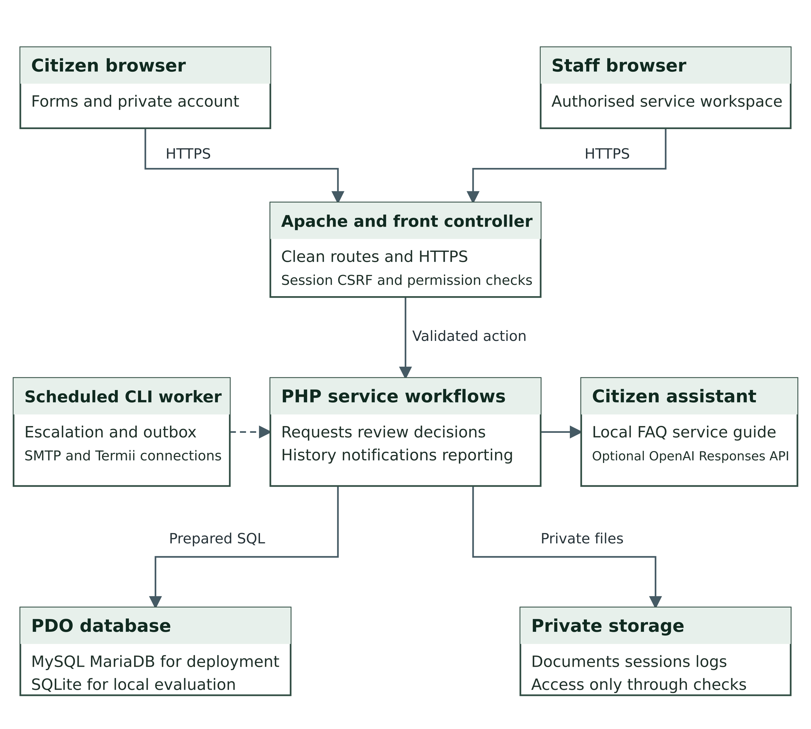
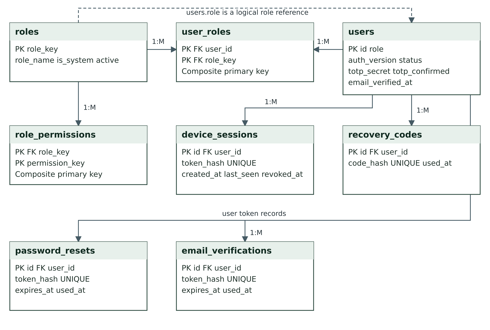
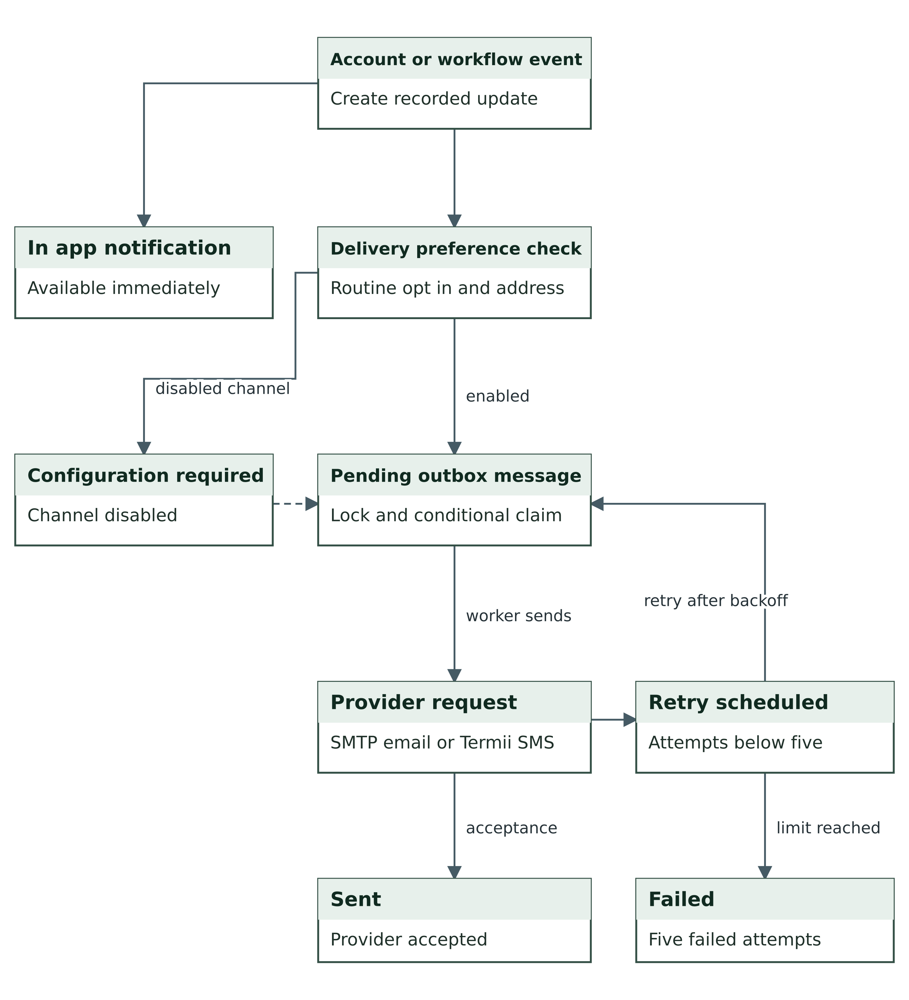
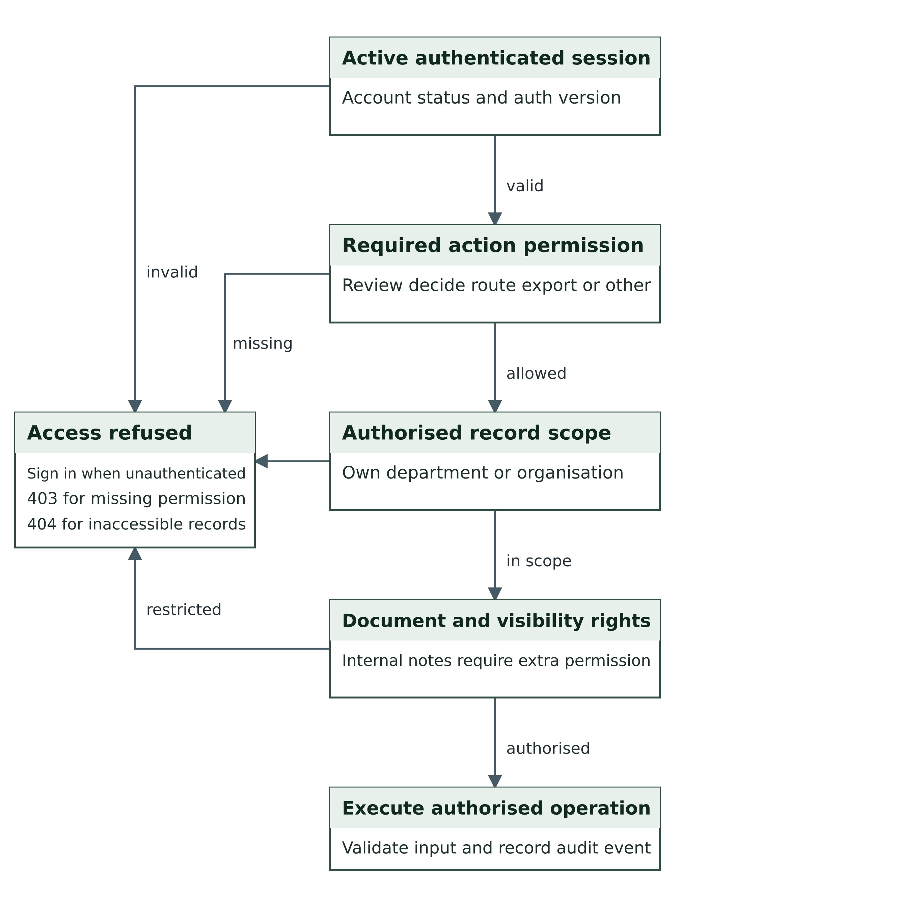

# System Design and Data Dictionary

Entity relationships architecture and workflow diagrams

Group 1   MIT 820   Application 1.0.4   Document 1.1   23 October 2026

This design document links the CivicFlow 1.0.4 application to its architecture, record relationships, workflow and permission decisions. The diagrams provide separate views to keep the 21-table schema readable. All columns and declared foreign keys appear in the dictionary. Dashed diagram links identify logical associations that are not database foreign keys.

## 1 Notation and data boundaries

PK denotes a primary key, FK a declared foreign key and UNIQUE a uniqueness constraint. A 1:M label means one to many. A solid relationship line represents a declared association shown in that view. Some repeated actor/uploader references appear as FK labels without an additional crossing line; the complete foreign-key table is authoritative. Optional fields are nullable. A logical reference is enforced by application behaviour without a declared database FK.

The citizen owns a request, the selected service supplies its default department, and current routing may change the processing department. The optional assignee is a staff user. Request versions guard concurrent edits. Templates and outbox messages retain distinct identities so a later template change does not rewrite queued content.

## 2 Architecture and diagrams

Figure D1 Application architecture

Source: Project implementation and system design for release 1.0.4.

Figure D2 Core service entity relationships

Source: Project implementation and system design for release 1.0.4.

Figure D3 Identity and permission relationships

Source: Project implementation and system design for release 1.0.4.

Figure D4 Communication and workspace relationships

Source: Project implementation and system design for release 1.0.4.

Figure D5 Complaint and permit lifecycle

Source: Project implementation and system design for release 1.0.4.

Figure D6 Delivery and retry workflow

Source: Project implementation and system design for release 1.0.4.

Figure D7 Server side access decision

Source: Project implementation and system design for release 1.0.4.

## 3 Complete schema data dictionary

The following tables list the declared columns and database foreign keys from the schema used by the source release. INTEGER primary identifiers use automatic numbering appropriate to the selected engine. The SQL schema remains the source for complete uniqueness and default-expression syntax. Operational permissions are defined in application code and role-permission records.

### departments

| Column | Type | Declared constraints |
| --- | --- | --- |
| id | INTEGER | PK; Required |
| name | VARCHAR(140) | Required |
| code | VARCHAR(20) | Required |
| description | TEXT | Required |

### services

| Column | Type | Declared constraints |
| --- | --- | --- |
| id | INTEGER | PK; Required |
| department_id | INTEGER | Required; FK departments.id |
| title | VARCHAR(180) | Required |
| slug | VARCHAR(100) | Required |
| kind | VARCHAR(20) | Required |
| description | TEXT | Required |
| requirements | TEXT | Required |
| fee | DECIMAL(12,2) | Required; Default 0 |
| sla_hours | INTEGER | Required; Default 72 |
| active | INTEGER | Required; Default 1 |

### roles

| Column | Type | Declared constraints |
| --- | --- | --- |
| role_key | VARCHAR(50) | PK; Required |
| role_name | VARCHAR(100) | Required |
| description | TEXT | Required |
| is_system | INTEGER | Required; Default 0 |
| active | INTEGER | Required; Default 1 |

### role_permissions

| Column | Type | Declared constraints |
| --- | --- | --- |
| role_key | VARCHAR(50) | PK composite; Required; FK roles.role_key |
| permission_key | VARCHAR(100) | PK composite; Required |

### users

| Column | Type | Declared constraints |
| --- | --- | --- |
| id | INTEGER | PK; Required |
| name | VARCHAR(140) | Required |
| email | VARCHAR(190) | Required |
| phone | VARCHAR(25) | Required; Default '' |
| password_hash | VARCHAR(255) | Required |
| role | VARCHAR(50) | Required; Default 'citizen' |
| department_id | INTEGER | Nullable; FK departments.id |
| status | VARCHAR(20) | Required; Default 'active' |
| email_verified_at | DATETIME | Nullable |
| notify_email | INTEGER | Required; Default 1 |
| notify_sms | INTEGER | Required; Default 0 |
| auth_version | INTEGER | Required; Default 1 |
| totp_secret | TEXT | Nullable |
| totp_confirmed | INTEGER | Required; Default 0 |
| created_at | DATETIME | Required |

### user_roles

| Column | Type | Declared constraints |
| --- | --- | --- |
| user_id | INTEGER | PK composite; Required; FK users.id |
| role_key | VARCHAR(50) | PK composite; Required; FK roles.role_key |

### email_templates

| Column | Type | Declared constraints |
| --- | --- | --- |
| id | INTEGER | PK; Required |
| template_key | VARCHAR(60) | Required |
| name | VARCHAR(140) | Required |
| subject | VARCHAR(180) | Required |
| html_body | TEXT | Required |
| plain_body | TEXT | Required |
| active | INTEGER | Required; Default 1 |
| updated_at | DATETIME | Required |

### device_sessions

| Column | Type | Declared constraints |
| --- | --- | --- |
| id | INTEGER | PK; Required |
| user_id | INTEGER | Required; FK users.id |
| token_hash | VARCHAR(64) | Required |
| ip_address | VARCHAR(64) | Required |
| user_agent | VARCHAR(250) | Required |
| created_at | DATETIME | Required |
| last_seen | DATETIME | Required |
| revoked_at | DATETIME | Nullable |

### recovery_codes

| Column | Type | Declared constraints |
| --- | --- | --- |
| id | INTEGER | PK; Required |
| user_id | INTEGER | Required; FK users.id |
| code_hash | VARCHAR(64) | Required |
| used_at | DATETIME | Nullable |

### requests

| Column | Type | Declared constraints |
| --- | --- | --- |
| id | INTEGER | PK; Required |
| reference | VARCHAR(50) | Required |
| access_token | VARCHAR(64) | Required |
| user_id | INTEGER | Required; FK users.id |
| service_id | INTEGER | Required; FK services.id |
| department_id | INTEGER | Required; FK departments.id |
| assigned_to | INTEGER | Nullable; FK users.id |
| kind | VARCHAR(20) | Required |
| subject | VARCHAR(180) | Required |
| description | TEXT | Required |
| location | VARCHAR(200) | Required; Default '' |
| state_name | VARCHAR(60) | Required; Default '' |
| organisation | VARCHAR(180) | Required; Default '' |
| priority | VARCHAR(20) | Required; Default 'normal' |
| status | VARCHAR(30) | Required |
| due_at | DATETIME | Nullable |
| escalated_at | DATETIME | Nullable |
| closed_at | DATETIME | Nullable |
| version | INTEGER | Required; Default 1 |
| created_at | DATETIME | Required |
| updated_at | DATETIME | Required |

### events

| Column | Type | Declared constraints |
| --- | --- | --- |
| id | INTEGER | PK; Required |
| request_id | INTEGER | Required; FK requests.id |
| actor_id | INTEGER | Nullable; FK users.id |
| from_status | VARCHAR(30) | Required; Default '' |
| to_status | VARCHAR(30) | Required; Default '' |
| message | TEXT | Required |
| visibility | VARCHAR(20) | Required; Default 'public' |
| created_at | DATETIME | Required |

### attachments

| Column | Type | Declared constraints |
| --- | --- | --- |
| id | INTEGER | PK; Required |
| request_id | INTEGER | Required; FK requests.id |
| user_id | INTEGER | Required; FK users.id |
| original_name | VARCHAR(200) | Required |
| stored_name | VARCHAR(100) | Required |
| mime | VARCHAR(100) | Required |
| size_bytes | INTEGER | Required |
| sha256 | VARCHAR(64) | Required |
| visibility | VARCHAR(20) | Required; Default 'public' |
| created_at | DATETIME | Required |

### notifications

| Column | Type | Declared constraints |
| --- | --- | --- |
| id | INTEGER | PK; Required |
| user_id | INTEGER | Required; FK users.id |
| request_id | INTEGER | Nullable |
| title | VARCHAR(180) | Required |
| body | TEXT | Required |
| link | VARCHAR(250) | Required |
| read_at | DATETIME | Nullable |
| created_at | DATETIME | Required |

### outbox

| Column | Type | Declared constraints |
| --- | --- | --- |
| id | INTEGER | PK; Required |
| user_id | INTEGER | Required; FK users.id |
| request_id | INTEGER | Nullable |
| channel | VARCHAR(15) | Required |
| recipient | VARCHAR(190) | Required |
| subject | VARCHAR(180) | Required |
| body | TEXT | Required |
| html_body | TEXT | Nullable |
| template_key | VARCHAR(60) | Nullable |
| state | VARCHAR(30) | Required; Default 'pending' |
| attempts | INTEGER | Required; Default 0 |
| next_attempt_at | DATETIME | Nullable |
| sent_at | DATETIME | Nullable |
| last_error | VARCHAR(250) | Required; Default '' |
| provider_id | VARCHAR(150) | Required; Default '' |
| created_at | DATETIME | Required |

### settings

| Column | Type | Declared constraints |
| --- | --- | --- |
| setting_key | VARCHAR(100) | PK; Required |
| setting_value | TEXT | Required |

### password_resets

| Column | Type | Declared constraints |
| --- | --- | --- |
| id | INTEGER | PK; Required |
| user_id | INTEGER | Required; FK users.id |
| token_hash | VARCHAR(64) | Required |
| expires_at | DATETIME | Required |
| used_at | DATETIME | Nullable |

### email_verifications

| Column | Type | Declared constraints |
| --- | --- | --- |
| id | INTEGER | PK; Required |
| user_id | INTEGER | Required; FK users.id |
| token_hash | VARCHAR(64) | Required |
| expires_at | DATETIME | Required |
| used_at | DATETIME | Nullable |

### audit_logs

| Column | Type | Declared constraints |
| --- | --- | --- |
| id | INTEGER | PK; Required |
| actor_id | INTEGER | Nullable |
| action | VARCHAR(100) | Required |
| entity_id | INTEGER | Nullable |
| metadata | TEXT | Required |
| ip_address | VARCHAR(64) | Required |
| created_at | DATETIME | Required |

### feedback

| Column | Type | Declared constraints |
| --- | --- | --- |
| id | INTEGER | PK; Required |
| request_id | INTEGER | Required; FK requests.id |
| user_id | INTEGER | Required; FK users.id |
| rating | INTEGER | Required |
| comment | TEXT | Required |
| created_at | DATETIME | Required |

### faqs

| Column | Type | Declared constraints |
| --- | --- | --- |
| id | INTEGER | PK; Required |
| question | VARCHAR(220) | Required |
| answer | TEXT | Required |
| keywords | VARCHAR(250) | Required |
| active | INTEGER | Required; Default 1 |

### announcements

| Column | Type | Declared constraints |
| --- | --- | --- |
| id | INTEGER | PK; Required |
| title | VARCHAR(180) | Required |
| body | TEXT | Required |
| active | INTEGER | Required; Default 1 |
| created_at | DATETIME | Required |

## 4 Declared foreign key register

| Referencing column | Referenced primary key |
| --- | --- |
| services.department_id | departments.id |
| role_permissions.role_key | roles.role_key |
| users.department_id | departments.id |
| user_roles.role_key | roles.role_key |
| user_roles.user_id | users.id |
| device_sessions.user_id | users.id |
| recovery_codes.user_id | users.id |
| requests.assigned_to | users.id |
| requests.department_id | departments.id |
| requests.service_id | services.id |
| requests.user_id | users.id |
| events.actor_id | users.id |
| events.request_id | requests.id |
| attachments.user_id | users.id |
| attachments.request_id | requests.id |
| notifications.user_id | users.id |
| outbox.user_id | users.id |
| password_resets.user_id | users.id |
| email_verifications.user_id | users.id |
| feedback.user_id | users.id |
| feedback.request_id | requests.id |

## 5 Logical reference register

| Field | Application relationship |
| --- | --- |
| users.role | Primary role key in roles, without a database FK. |
| outbox.request_id | Optional service request link, without a database FK. |
| outbox.template_key | Optional template key retaining the queued message provenance. |
| notifications.request_id | Optional service request link, without a database FK. |
| audit_logs.actor_id | Optional user actor link, without a database FK. |

## 6 Diagram source files

Each diagram is included as a high-resolution PNG and editable SVG. The source architecture/workflow document also provides Mermaid definitions. The field dictionary and SQL references resolve any detail omitted from the selected diagram lines. Diagram files are design models, not screenshots or proof of a hosted deployment.

## 7 Additional formal and deployment views

The Architecture Design Document provides the architectural alternatives, decisions, threat considerations and single-instance deployment assumptions. The diagram collection adds a UML-style use case view and submission sequence, a deployment topology and two interface wireframes. PNG files provide ready-to-display images; SVG and Mermaid sources remain editable. Wireframes are design views, not evidence of a live browser test.

Figure 7.1 Principal actors and use cases

Figure 7.2 Submission and information reply sequence

Figure 7.3 Single instance deployment topology
