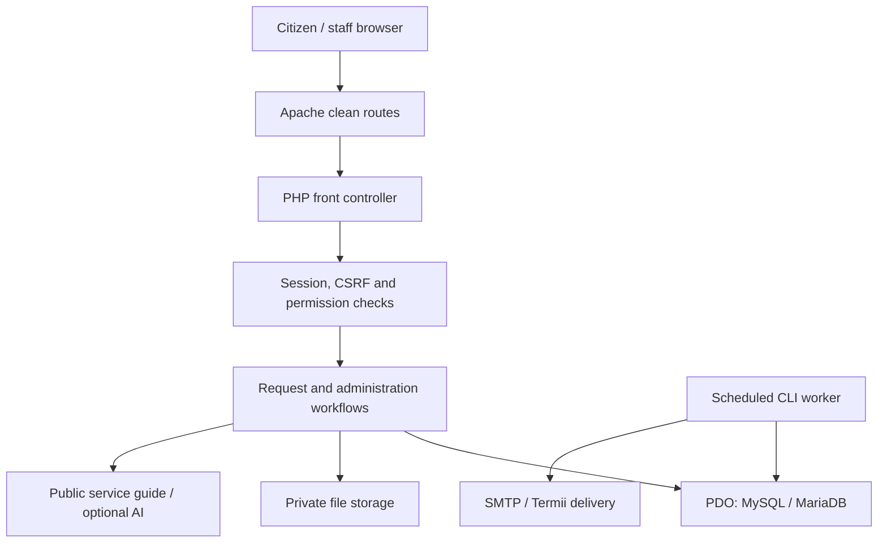
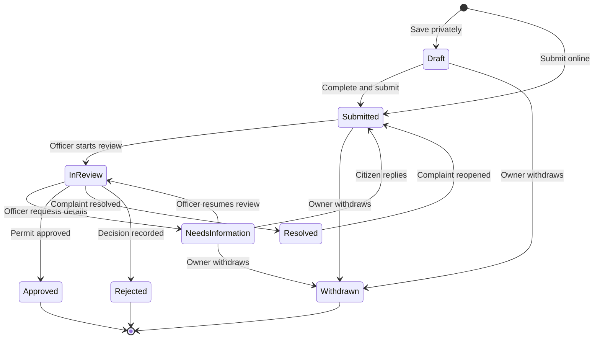
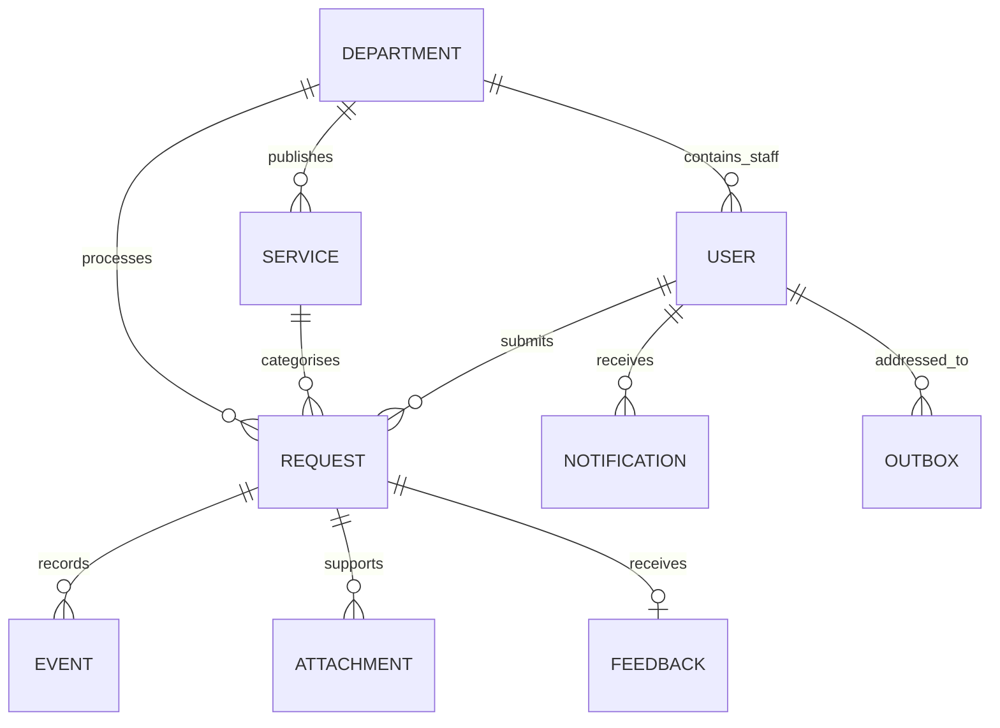
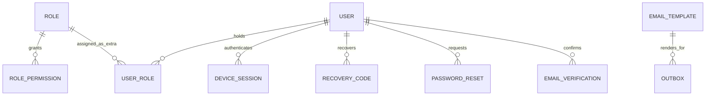
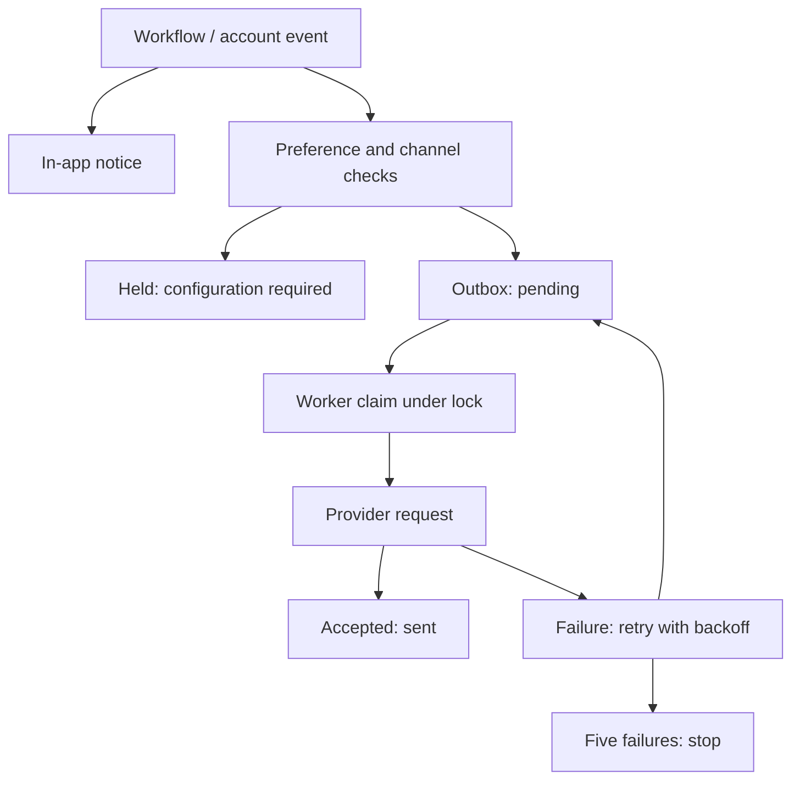

# Architecture and workflow

## Application boundary

The browser uses clean routes served through Apache's front controller. PHP controls authentication, permissions and workflow decisions; PDO persists records. Private storage holds uploads, session files and operational state. Scheduled CLI jobs perform escalation and external delivery.

`router.php` is a local development equivalent. It is not the production web server. All external calls are server-side, with TLS verification. API secrets do not enter page markup or client JavaScript.

## Request lifecycle

A version number guards decisions, assignment and draft updates against stale writes. Workflow changes, history and notifications are committed together. Files moved during a failed transaction are removed. Reopening sets a fresh target and clears prior feedback.

## Core data relationships

`requests.assigned_to` also references a staff user. Request ownership, selected service department and current routing department are separate fields so routing can change without replacing the request record.

The primary role is stored on `users.role`; additional roles use `user_roles`. Template keys on outbox records are references for traceability, while each message stores its rendered body so later template edits do not alter queued text. Reset/verification tokens and recovery codes are stored as hashes. MFA and provider secrets are encrypted under the installation key.

## Permission evaluation

A request begins with an active session and account version. The application loads permissions from active primary/additional roles, except the protected administrator role which has the full catalogue. SQL lists use the user's scope and individual record reads enforce it again. Mutations require action permission independently of whether a page or menu item is visible. Downloads also require document permission, request scope and internal-document permission where applicable.

Draft privacy is enforced on individual reads as well as staff lists. Scope precedence is organisation, department, then own. Default citizen permissions can only remain within the allowed public capability set.

## Notification processing

The job checks disabled channels before delivery and conditionally claims pending/retry rows. Cancellation cannot claim a processing record. Provider acceptance is recorded, but a crash around a provider acknowledgement can still cause a repeated delivery attempt. The system does not claim exactly-once transport.

## File and configuration boundary

- Root `.htaccess` denies private directories, dot paths, SQL/log/archive artifacts and setup instructions.
- Each private directory also carries a denial file. Uploaded files have random names, validated MIME types and scoped download routes.
- Application configuration and install lock are generated locally after setup. There is no bundled live database or account password.
- SQL reference files are generated from the same schema definitions used by the installer.
- The application uses a single-instance cPanel topology. Multi-node sessions, shared files, distributed rate limiting and operational monitoring are deployment extensions.
