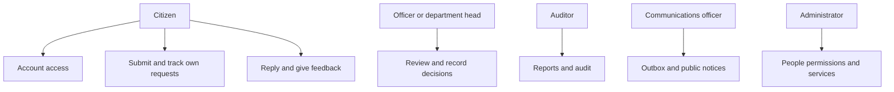
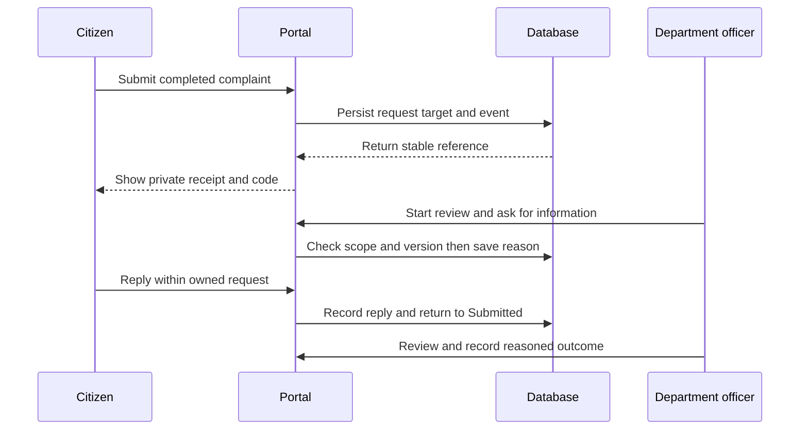
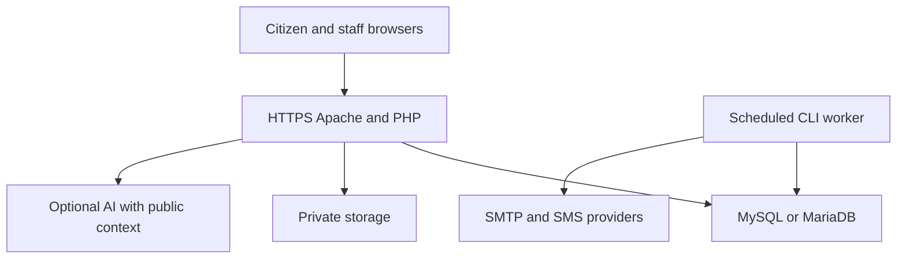

# Additional formal model sources

These editable Mermaid sources complement the rendered SVG and PNG views in the diagram gallery.

## Use case associations

## Submission and information reply sequence

## Deployment topology

