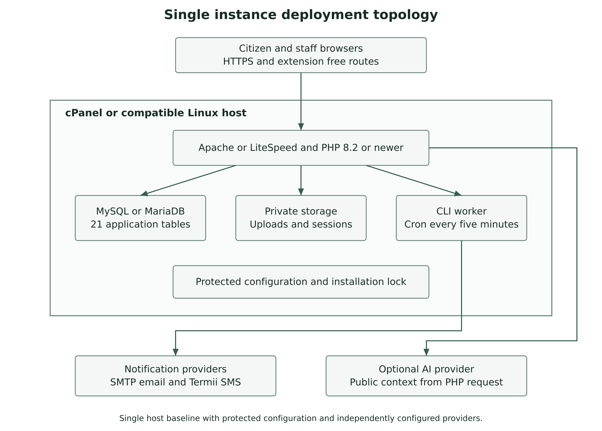
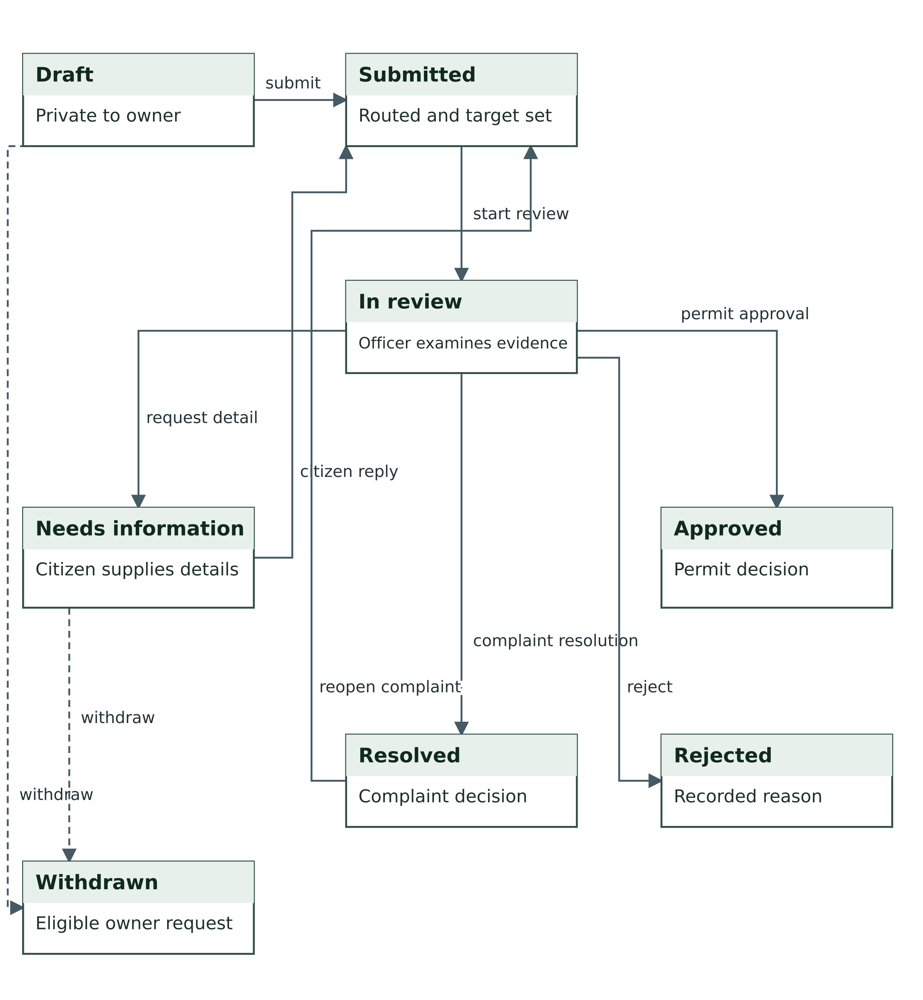
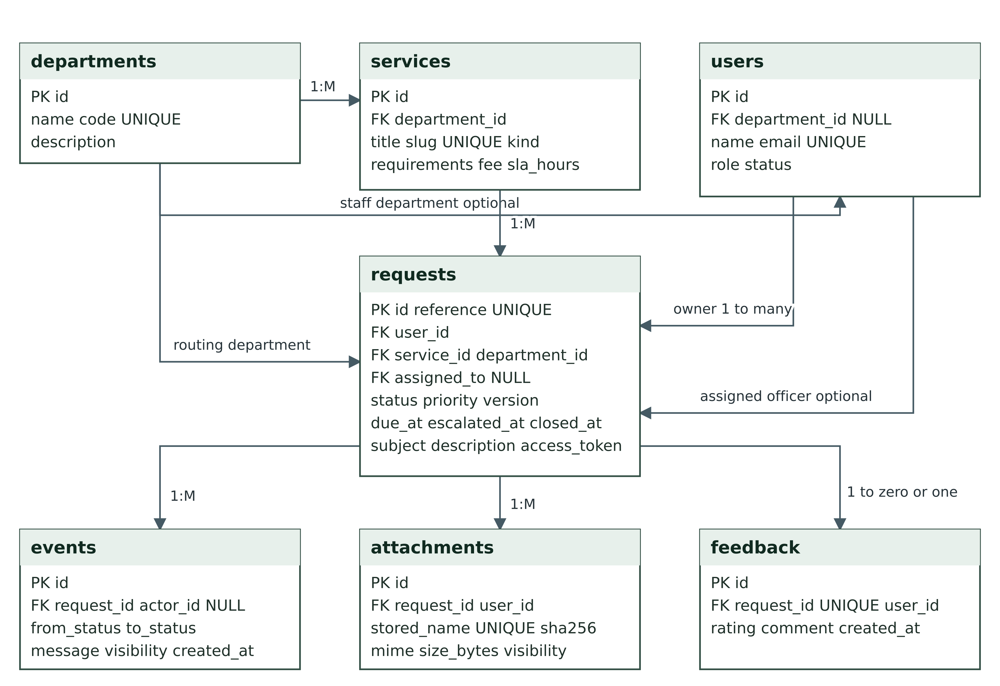

# Architecture and models

CivicFlow uses a front controller, shared permission checks, PHP workflow modules, PDO and protected private storage. A scheduled CLI worker handles escalation and queued delivery. Optional AI receives public service context through the web request path and has no private-case or decision tool.

The [ADD](../academic/Architecture_Design_Document.md) records alternatives, decisions, consequences and quality targets. The [data dictionary](../academic/System_Design_and_Data_Dictionary.md) preserves all 21 tables and distinguishes declared foreign keys from logical references.

## Request lifecycle

## Data relationships

See the [complete diagram gallery](../DIAGRAMS.md) for access, communications, sequence, use cases and wireframes. PNG images render directly. SVG and Mermaid sources remain available for editing.
